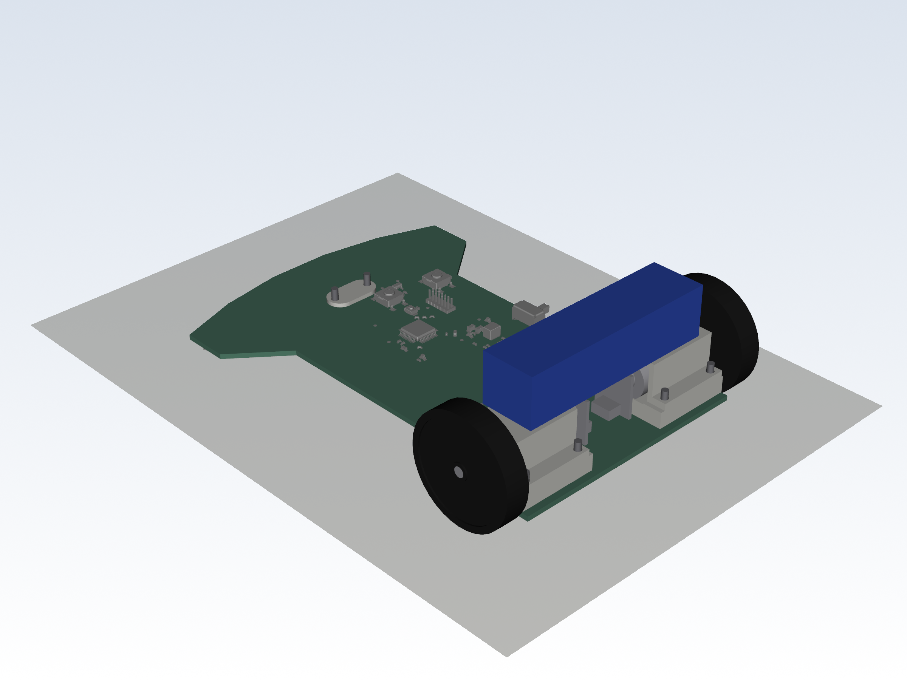

# circuit-forge-seguidor

Speed Follower (seguidor de línea de velocidad) del equipo **Circuit Forge** para **Robolympics RMX2026**, categoría
Seguidores de línea: sábado 21 de noviembre de 2026, Tec de Monterrey campus León.

> **Rama `engineering/final-robot-v2`:** desarrollo del robot V2 (alta velocidad con succión), Fase 1 entregada en
> [`docs/v2/`](docs/v2/README.md). Lo que sigue describe V1, que se conserva como referencia.

> **Una sola configuración vigente**, cerrada para fabricación: [`docs/ARQUITECTURA.md`](docs/ARQUITECTURA.md), con todos
> sus parámetros en [`config/robot_maestro.yaml`](config/robot_maestro.yaml). Lo que está en [`legado/`](legado/README.md)
> es **histórico** y no se debe usar para construir.



## Estado

Ingeniería cerrada y lista para fabricar: PCB-chasis de 4 capas con STM32G431, DRV8833 y 16 sensores QRE1113GR, motores
Pololu HPCB 12 V 10:1 con encoder, batería 2S de 450 mAh. Masa 112.9 g y huella 132 × 92 mm en el CAD. Simulado:
**5.81 s por vuelta y 100 % de éxito en 200 salidas** (modo seguro: 7.16 s, 100 %). ERC, DRC con paridad, conectividad,
interferencias mecánicas y compilación del firmware **sin errores**. **Nada se ha fabricado, armado ni medido**: falta la
validación física (pruebas E1-E9 y mediciones M1-M8 del manual). Detalle: [`docs/ESTADO_PROYECTO.md`](docs/ESTADO_PROYECTO.md)
y [`docs/VALIDACION_FINAL.md`](docs/VALIDACION_FINAL.md).

## Estructura

| Ruta | Contenido |
|---|---|
| `config/robot_maestro.yaml` | **Única fuente de parámetros** (reglamento, geometría, componentes con masa y posición del CAD, motores, sensores, MCU, control, firmware). Cada valor indica su origen |
| `docs/ARQUITECTURA.md` | Configuración definitiva y por qué |
| `docs/BOM_FINAL.csv` | Lista de compra: fabricante, modelo, número de parte, cantidad, tensión, corriente, dimensiones, masa, encapsulado, huella, función, hoja de datos, montaje (categorías A-G) |
| `docs/MANUAL_ENSAMBLAJE.md` | Fabricación, ensamble, pruebas de aceptación E1-E9, calibración y mediciones |
| `docs/CALCULOS_ELECTRICOS.md` | Corrientes y anchos de pista, caídas, regulador, sensores, ADC, pines (generado) |
| `docs/VALIDACION_FINAL.md` · `docs/ESTADO_PROYECTO.md` | Qué se verificó, con qué herramienta, y qué falta |
| `docs/AUDITORIA_ROBUSTEZ.md` · `docs/SIMULACION_DINAMICA.md` | Robustez del control final; modelo, pruebas y resultados del simulador |
| `docs/REGLAMENTO_MATRIZ.md` · `docs/CALCULOS_FISICOS.md` · `docs/VERIFICACION_FASE1.md` | Reglamento → requisitos; cálculos de la Fase 1 (históricos) |
| `hardware/electronics/` | Proyecto **KiCad 9** (esquemático jerárquico y PCB ruteada), generadores, verificaciones, **paquete de fabricación** (`fabricacion/`) y vistas 2D/3D de la PCBA (`pcba/`) |
| `hardware/mechanical/` | **CAD** del robot completo: piezas impresas (STEP/STL), planos, ensamble STEP, vistas, verificación mecánica |
| `firmware/` | Firmware del STM32G431 (lógica C++ verificada contra el simulador + capa de hardware con CMSIS); compila con arm-none-eabi-gcc |
| `sim/` | Simulador dinámico, experimentos y resultados (`sim/resultados/final/` para la configuración definitiva) |
| `herramientas/` | Generadores de la BOM y de la configuración del firmware |
| `pruebas/` | `ejecutar_todo.sh` corre todas las pruebas; `registro_ejecutar_todo.txt` es la última corrida |
| `legado/` | Diseños históricos (no vigentes) |
| `modificaciones/` | Plantilla para registrar cambios hechos en el robot físico |

## Reproducir

```bash
pip install numpy numba scipy shapely pyyaml matplotlib cadquery   # Python ≥ 3.10
sudo apt-get install g++ gcc-arm-none-eabi libnewlib-arm-none-eabi libstdc++-arm-none-eabi-newlib   # + KiCad 9
pruebas/ejecutar_todo.sh                          # todas las pruebas (≈ 30 s con los resultados ya generados)
hardware/electronics/generar_fabricacion.sh       # esquemático, PCB, ERC/DRC, paquete de fabricación, vistas 2D/3D
python3 hardware/mechanical/cad/generar_cad.py    # CAD mecánico, STEP/STL, planos, vistas
python3 sim/fase_final.py Z R E S F G             # simulación de la fase final (horas con 2 núcleos)
cd firmware/stm32 && make                         # firmware (Windows: ver firmware/README.md)
```

## Equipo

Alejandro Avilés Flores · Alan Uzuel Vargas Zavala · Daniel Navarro Robledo. Contacto de la organización: camilo.duque@tec.mx.
