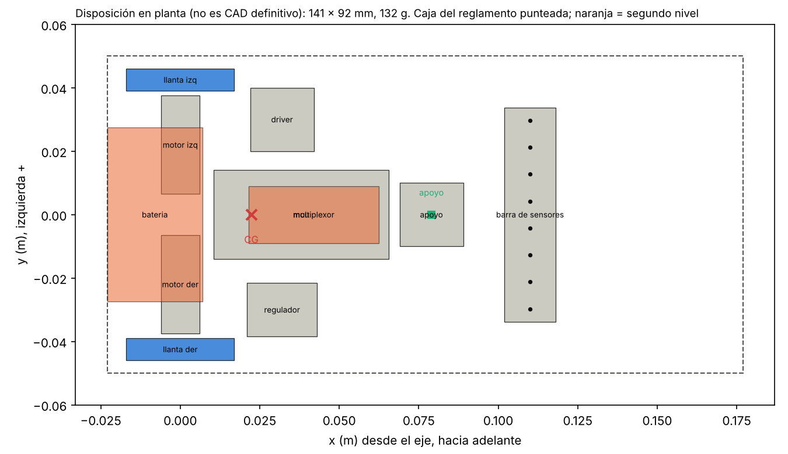

# Arquitectura vigente — Speed Follower de $2,000 MXN (Fase 3)

Fecha: 1 nov 2026 · Parámetros: [`config/robot_maestro.yaml`](../config/robot_maestro.yaml) · BOM: [`BOM_FINAL.csv`](BOM_FINAL.csv) · Evidencia: `sim/resultados/fase3/`.
Etiquetas: **[F]** fabricante · **[F-vendedor]** dato del anuncio, sin ficha técnica · **[C]** calculado · **[Sim]** simulado · **[E]** estimado · **[S]** supuesto · **[Pendiente de medición]**. Nada está construido ni medido.

## 1. Arquitectura

| Bloque | Selección | Por qué |
|---|---|---|
| Motores | **Chihai CHF-GM12-N20, 12 V, 2200 rpm, i10, con encoder** (×2) | El más rápido de los candidatos en la etapa T (5.26 s, 100 %) y la menor corriente (0.34 A pico). Trae encoder para un modo con mapa futuro. Su par y su bloqueo **no están publicados**: estimados con η = 0.79 y en análisis de sensibilidad |
| Barra | **Clon QTR-8A, 8 × TCRT5000, recta, 65.7 × 16 mm** | Igual o mejor que la barra en arco con PCB propia en la simulación (lee 8 canales sin resta de luz ambiente → ciclo de 1 ms en vez de 2.2 ms) y cuesta $61 frente a varios cientos de una PCB propia |
| MCU | **ESP32 DevKit 38 pines (WROOM-32)** | El firmware ya existe; el STM32G431 no mejoró el tiempo de vuelta (etapa B de la Fase 2). Radio apagada por firmware |
| Driver | **TB6612FNG** | Ficha conocida (1.0 A continuos, 2 A de pico); el bloqueo a 8.4 V es ≈ 0.35 A [S] → margen ×2.8. El módulo DRV8833 disponible no indica su encapsulado |
| Batería | **LiPo 2S 300-450 mAh, ≥ 20 C** | 7.4 V nominales; los motores de 12 V nunca rebasan su tensión; el driver admite 8.4 V |
| Regulación | MP1584EN a 5 V → VIN del ESP32 y barra; 3.3 V del ESP32 → mux y lógica del driver | |
| Control | **C3m**: perfil de velocidad por curvatura (error + modelo del motor), feed-forward, persecución pura, PD, piso de −0.07; v_max 0.66 m/s | Mejor que C2 sin agregar hardware (−9 % en la Fase 2) |
| IMU | **No** | C3g (giroscopio) no superó a C3m. Se pierde: medir la guiñada real y detectar derrapes |
| Succión | **No** | Deshabilitada por indicación (fuera de presupuesto y sin autorización de los organizadores) |
| Geometría | Cuello de 110 mm, vía de 85 mm, llanta de 34 mm, apoyo de bola a 79 mm, batería 8 mm detrás del eje | Etapa D de la Fase 2 y disposición en planta (`hardware/mechanical/`) |
| Masa | **132 g** [E] (límite de diseño 450 g; reglamento 500 g) | CG a 22.4 mm delante del eje; f_motriz 0.72 |

## 2. Costo

`python3 herramientas/presupuesto.py`: **$1,361 de componentes estimados + $150 de reserva = $1,511 de $2,000**. Con el máximo permitido por partida: $1,846. Precio objetivo (las ofertas más bajas observadas): $876. Partidas con precio por verificar antes de comprar: $1,010 del estimado (motores, envío, batería, consumibles). Los precios son los observados el 31 oct en UNIT y AliExpress o estimaciones marcadas como tales; **no son cotizaciones**. El cargador (herramienta) no está incluido.

Con los ≈ $490 que sobran, se recomienda (no incluido): un motor de repuesto, una segunda barra y un segundo driver.

## 3. Qué cambió respecto a la Fase 2

| Componente | Fase 2 | Fase 3 | Motivo |
|---|---|---|---|
| Motores | Pololu HPCB 12 V 15:1 | Chihai N20 12 V i10 | Pololu: sin precio documentado ni distribuidor en México |
| Barra | Arco de 16 × QRE1113 en PCB propia | Clon QTR-8A comercial | Costo, tiempo de fabricación y rendimiento simulado igual o mejor |
| Driver | DRV8833 (PWP) | TB6612FNG | Ficha conocida del módulo disponible |
| Control | C3m | C3m, reajustado con margen de derrape | |
| MCU | ESP32 | ESP32 | Sin cambio |

## 4. Rendimiento simulado

| | Fase 2 (Pololu + arco16c) | Fase 3 vigente |
|---|---|---|
| Ajuste agresivo, etapa T (200 salidas) | 5.70 s, 100 % | 5.26 s, 100 %, **sobre la disposición previa**; en la definitiva los mismos parámetros bajan a 92 % |
| Ajuste robusto (margen de derrape), misma disposición, 200 salidas | 6.22 s, 100 % | 6.85 s, 100 % |
| **Configuración vigente** (v_max 0.66) | — | **6.35 s, 100 % (IC 98.1-100 %)** |
| Corriente pico por motor | 0.44 A | 0.34 A |
| Costo | No presupuestable (Pololu y PCB sin precio) | $1,511 con reserva |

**Lectura honesta:** con el mismo procedimiento robusto, la arquitectura de $2,000 es entre un 2 % y un 10 % más lenta que la de la Fase 2. La diferencia depende de dos supuestos que hay que medir: el par del motor Chihai y el ruido de la barra clon.

## 5. Compromisos técnicos del límite de $2,000

1. **Motores sin ficha técnica:** su par y su bloqueo son estimaciones. Con un bloqueo real ≥ 0.8 A, el control ajustado derrapa (57 % de éxito) hasta que se mida el motor y se reajuste.
2. **Barra sin resta de luz ambiente:** el clon no documenta un pin para apagar los LED. Con 3× el ruido supuesto, el éxito cae al 50 %. Además, la luz ambiente fuerte es un riesgo (R06).
3. **Sin PCB propia:** cableado de módulos en placa perforada. Hay más masa de cables y conectores que pueden aflojarse.
4. **Sin IMU ni encoders en uso:** el control no mide la velocidad real. El encoder del Chihai queda disponible, pero sin firmware.
5. **Sin succión:** es la palanca más grande que se descarta (−22 a −34 % de tiempo en la Fase 2).
6. **Calendario:** los motores Chihai se muestran con entrega del 19 al 28 nov. El respaldo es el GA12-N20 6 V local, con 5.64 s simulados y parámetros `control.C3m_ga12` que **deben reajustarse con el motor medido**.

## 6. Compatibilidad eléctrica (`hardware/electronics/verificar_electrica.py`, [C])

| Comprobación | Valor | Límite |
|---|---|---|
| VM con la batería llena | 8.4 V | TB6612: 13.5 V recomendado, 15 V absoluto |
| Bloqueo por motor a 8.4 V | 0.35 A [S] | 1.0 A continuos |
| Frenado inverso desde la velocidad libre | 0.65 A [S] | 2 A de pico |
| Corriente total máxima (bloqueo doble + lógica) | 0.82 A | PTC de 1.5 A |
| Entradas analógicas | GPIO34 (mux) y GPIO36 (batería), ADC1 | |
| Barra a 5 V hacia el mux a 3.3 V | **aviso** | 10 kΩ en serie por canal (BOM R1) o alimentar la barra a 3.3 V |
