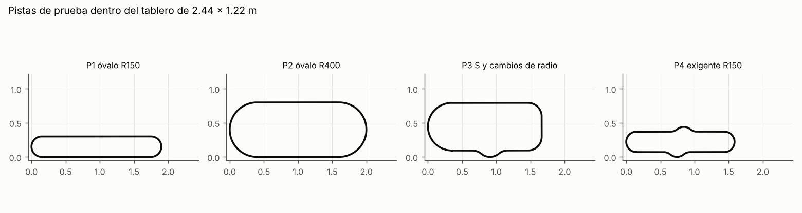
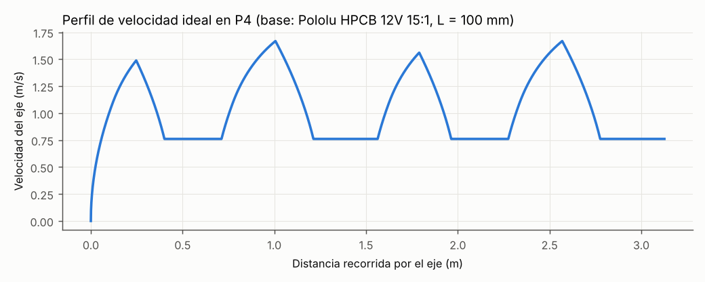
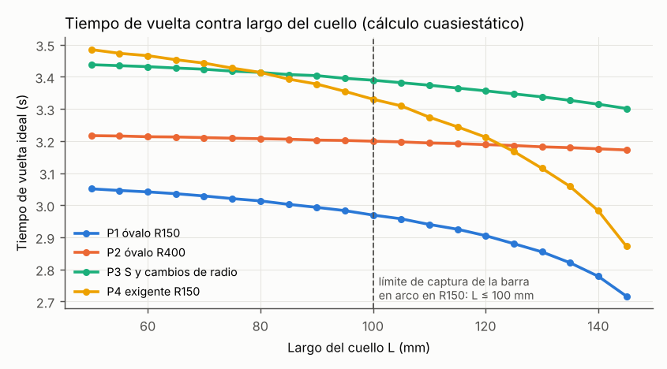
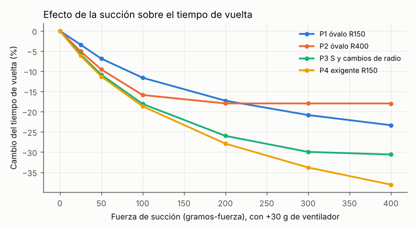
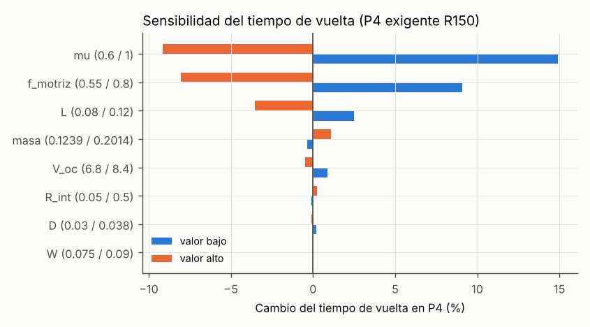

# Cálculos físicos — Fase 1

Fecha: 1 nov 2026 · Rama `engineering/speed-follower`.

> **Estado (Fase 2):** este documento es la evidencia de la Fase 1 y **no** predice el rendimiento. La verificación independiente ([VERIFICACION_FASE1.md](VERIFICACION_FASE1.md)) encontró cuatro omisiones: la inercia de los rotores, la transferencia de carga (al frenar baja el agarre de 5.18 a 4.6 m/s²), el reparto de la succión (0.80, no 0.90) y la masa y el CG, ahora calculados de los componentes. Los tiempos de vuelta de aquí son cotas cuasiestáticas; los tiempos esperados están en [SIMULACION_DINAMICA.md](SIMULACION_DINAMICA.md).

**Reproducir:** `python3 sim/fase1/calculos_fisicos.py` (Python 3.13.17, numpy 2.5.3, PyYAML 6.0.3, matplotlib 3.11.2; tarda unos 15 s). Lee la configuración v1 congelada en `sim/fase1/robot_maestro_v1.yaml` y escribe `sim/resultados/fase1/C0…C10.csv` y `F0…F4.png`.

Etiquetas: **[Calculado]** sale de una ecuación con los parámetros del YAML · **[Fabricante]** hoja de datos · **[Fab.-extrapolado]** el propio fabricante extrapola el dato · **[Supuesto]** sin fuente, se debe medir · **[Pendiente de medición]**.
Nada de este documento se ha medido en hardware. Las conclusiones dependen sobre todo de dos supuestos, μ = 0.80 y f_motriz = 0.66, y ambos hay que medirlos (§9).

## 0. Resumen

| Hallazgo | Evidencia | Consecuencia de diseño |
|---|---|---|
| El tiempo de vuelta lo limita el **agarre**, no el motor | Sensibilidad en P4: μ 0.6 → 1.0 cambia el tiempo de +15 % a −9 %; masa ±30 % lo cambia ≈ 1 %; el motor, ≤ 7 % | Invertir en agarre: llanta, reparto de peso y, si se permite, succión |
| Un apoyo de bola **no aporta fuerza lateral**; solo cuenta el peso sobre las ruedas | Modelo de §2 | Llevar la batería y la masa sobre el eje: f_motriz 0.66 → 0.80 ahorra ≈ 8 % |
| La **succión** es la palanca más grande | +100 gf → −12 a −19 %; +200 gf → −17 a −28 % (C3) | Dejar previsto un ventilador; decidir según la respuesta de los organizadores y la succión medida |
| Con succión, el motor 12 V 15:1 pasa a ser el límite | Con 200 gf, el 6 V 15:1 limitado a 6 V es 10-21 % más rápido (C10) | Elegir el motor **después** de decidir la succión |
| Cuello: más largo es más rápido en papel, pero la barra pierde la línea | Barra en arco: captura en R150 hasta L = 100 mm; barra recta, hasta 90 mm (C2) | **L = 100 mm con barra en arco** de radio 100 mm |
| El freno lo limita el agarre, no el motor | Inverso: 17-27 m/s² disponibles frente a 5.2 de agarre (C5) | Frenar con inverso limitado o con freno corto; no hace falta más motor para frenar |
| No hay sobretensión por regeneración en 2S | FEM máxima 6.8 V a 2.5 m/s, menor que 8.4 V (C5) | DRV8833 (VM ≤ 10.8 V) es seguro en 2S; **nunca en 3S** |
| Lazo de control: 2 ms es el límite a 2 m/s | Medio paso de sensor en 2.2 ms (paso 8 mm, L 100) (C6) | Objetivo de periodo ≤ 1 ms; restricción para elegir el MCU |
| La masa estimada (155 g) está muy por debajo de 450 g | C7 | La masa **no** es el problema; el chasis es el 28 % |

## 1. Parámetros base

Todos vienen de `config/robot_maestro.yaml`.

| Parámetro | Valor | Origen |
|---|---|---|
| Motor | Pololu HPCB 12 V 15:1: 2200 rpm, 0.08 A en vacío, 0.25 kg·cm y 0.75 A de bloqueo a 12 V | [Fabricante] rpm e I en vacío; [Fab.-extrapolado] bloqueo |
| Constantes derivadas | R = 16.0 Ω; Ke = 0.04653 V·s/rad; Kt = 0.03659 N·m/A (a la salida de la reductora; incluye su eficiencia) | [Calculado] |
| Llanta, vía, cuello | D 34 mm; W 85 mm; L 100 mm | Decisión; D [Pendiente de medición] |
| Masa | 154.9 g (presupuesto C7) | [Calculado] sobre estimados |
| μ llanta-fórmica | 0.80 | [Supuesto] |
| f_motriz (fracción del peso sobre las ruedas) | 0.66 | [Calculado] con el CG del chasis anterior (auditoría H09) |
| Batería | 2S: 8.4 / 7.4 / 6.8 V; R interna + cableado 0.20 Ω | [Fabricante] voltajes; R [Supuesto] |
| Resistencia de rodadura | 1.5 % del peso | [Supuesto] |

## 2. Modelo y ecuaciones

**Motor (modelo lineal de DC con datos del fabricante):**
R = V_nom / I_bl · Ke = (V_nom − I₀R) / ω₀ · Kt = T_bl / (I_bl − I₀)
Corriente I = (V_ap − Ke·ω)/R · par de salida T = Kt·(I − I₀).
Batería con caída: V_bus = (V_oc + 2 R_int Ke ω / R − R_int I_lógica) / (1 + 2 R_int / R).
*Limitaciones:* Pololu no publica la curva completa del 12 V 15:1; el modelo lineal es una **aproximación** construida con 4 puntos, y los de bloqueo son extrapolados por el fabricante. No se modelan la inercia del rotor, la temperatura ni la variación de la eficiencia de la reductora con la carga.

**Agarre con apoyo de bola:** el apoyo gira en cualquier dirección y no aporta fuerza lateral ni de frenado. Toda la fuerza (lateral y longitudinal) sale de las dos llantas motrices:
N_m = f_motriz·m·g + f_succ·F_succ  →  a_max = μ·N_m / m
Ambas fuerzas comparten el **círculo de fricción**: a_lon² + a_lat² ≤ a_max².
Base: a_max = 0.80 · 0.66 · 9.81 = **5.18 m/s²** [Calculado].

**Geometría del cuello en curva:** con la barra a L delante del eje y centrada sobre una línea de radio R, el eje describe un círculo de radio
R_eje = √(R² − L²)
En R = 150 mm y L = 100 mm: R_eje = 111.8 mm. El eje corta la curva (recorre menos distancia), pero va más lento: v_eje ≤ √(a_max · R_eje) = 0.76 m/s [Calculado]. Además, la rueda exterior no puede pasar de la velocidad libre: v_eje ≤ v_libre / (1 + W/(2 R_eje)).

**Vuelta cuasiestática (`perfil`):** velocidad máxima del eje en cada milímetro, con una pasada hacia atrás (frenado limitado por motor y agarre) y otra hacia adelante **desde parado** (C05 del reglamento: una vuelta cronometrada desde la salida). Supone seguimiento perfecto: no hay control, ni latencia, ni transitorios de entrada a curva. **Es una cota inferior del tiempo de vuelta**, útil para comparar opciones, no para predecir el tiempo real. El simulador con control de la Fase 2 dará el tiempo esperado.

## 3. Pistas de prueba (C0, F0)

Cuatro pistas que cumplen el reglamento, verificadas por el script: cierre < 5 mm, giro total de 360°, caben en 2.44 × 1.22 m con 6 cm de margen, separación ≥ 20 cm entre tramos lejanos y R ≥ 150 mm. Las chicanas son de 40°-80°-40°, para que ningún arco suelto llegue a 90°; las U son de 180° (ver la pregunta 4 de la matriz).

| Pista | Línea (m) | Radio mínimo | Qué representa |
|---|---|---|---|
| P1 óvalo R150 | 4.14 | 150 mm | Rectas largas + la U más cerrada |
| P2 óvalo R400 | 4.91 | 400 mm | Pista rápida |
| P3 S y cambios de radio | 4.30 | 200 mm | Chicana en S, U compuesta de 2 × 90° y U de 350 mm |
| P4 exigente R150 | 3.58 | 150 mm | Dos chicanas R150 y dos U R150 |

## 4. Resultado base (C9)

| Pista | Vuelta ideal | Velocidad media (línea / tiempo) | Velocidad máxima |
|---|---|---|---|
| P1 | 2.97 s | 1.40 m/s | 2.12 m/s |
| P2 | 3.20 s | 1.54 m/s | 2.10 m/s |
| P3 | 3.39 s | 1.27 m/s | 2.06 m/s |
| P4 | 3.33 s | 1.08 m/s | 1.67 m/s |

[Calculado] Velocidad libre del robot a 7.4 V: 2.17 m/s. Son cotas inferiores (§2): el robot real será más lento.

## 5. Cuello y barra de sensores (C2, F1)

**Captura en el peor caso:** el eje entra a una curva de R = 150 mm con el robot todavía recto. La línea aparece en la barra desplazada:
- barra **recta** a L del eje: y = R − √(R² − L²)
- barra **en arco** de radio L centrada en el eje: y = L·sin(asin(L/2R))

La barra debe ver el centro de la línea (± 12.5 mm de medio ancho) dentro de su semiancho útil: 100/2 − 4 mm de holgura = **46 mm**.

| L (mm) | R_eje en R150 | Lateral, barra recta | Lateral, barra en arco | Captura recta | Captura arco | Vuelta P4 |
|---|---|---|---|---|---|---|
| 80 | 126.9 | 23.1 | 21.3 | sí | sí | 3.41 s |
| 90 | 120.0 | 30.0 | 27.0 | sí | sí | 3.38 s |
| 100 | 111.8 | 38.2 | 33.3 | no | **sí** | 3.33 s |
| 110 | 102.0 | 48.0 | 40.3 | no | no | 3.27 s |
| 130 | 74.8 | 75.2 | 56.3 | no | no | 3.11 s |

[Calculado] En papel, un cuello más largo siempre es más rápido, porque el eje corta más las curvas y el tiempo en curva crece con √R_eje. Pero por encima de L = 100 mm (barra en arco) o de 90 mm (barra recta), la barra deja de ver la línea al entrar a una curva R150.
**Decisión propuesta: L = 100 mm, barra en arco de radio 100 mm.** El semiángulo es 27.4°, el arco mide 95.6 mm y la cuerda 92 mm; caben 13 sensores a 8 mm o 16 a 6.35 mm (un multiplexor de 16 canales).
*Limitación:* es un criterio geométrico de peor caso. El control empieza a girar antes de llegar a ese desplazamiento, así que el límite real puede ser un poco mayor; la Fase 2 lo comprobará con el simulador. El diseño anterior (L = 130 mm, barra recta) **no captura** la curva R150 en el peor caso.

## 6. Agarre y succión (C3, C10, F2, F3)

**Sensibilidad en P4 (C4):**

| Parámetro (bajo / alto) | Cambio del tiempo de vuelta |
|---|---|
| μ (0.60 / 1.00) | +14.9 % / −9.2 % |
| f_motriz (0.55 / 0.80) | +9.1 % / −8.0 % |
| L (80 / 120 mm) | +2.5 % / −3.6 % |
| Masa (124 / 201 g) | −0.4 % / +1.1 % |
| Batería (6.8 / 8.4 V) | +0.9 % / −0.5 % |
| D llanta (30 / 38 mm) | +0.2 % / −0.1 % |

La masa casi no importa porque, sin succión, el agarre crece en proporción a la masa; solo pesa donde el motor limita la aceleración.

**Succión (C3), con 30 g de ventilador [Supuesto] y el 90 % de la fuerza sobre las ruedas [Supuesto]:**

| Succión | a_max | v en curva R150 (eje) | P1 | P2 | P3 | P4 |
|---|---|---|---|---|---|---|
| 0 gf | 5.2 m/s² | 0.76 m/s | 2.97 s | 3.20 s | 3.39 s | 3.33 s |
| 100 gf | 9.0 | 1.00 | −11.6 % | −15.9 % | −18.1 % | −18.7 % |
| 200 gf | 12.8 | 1.20 | −17.3 % | −17.9 % | −26.0 % | −27.9 % |
| 400 gf | 20.5 | 1.51 | −23.3 % | −18.0 % | −30.6 % | −38.1 % |

[Calculado] **Punto de equilibrio:** la succión compensa sus 30 g de masa extra cuando F_succ > f_motriz · m_ventilador / f_succ = 0.66 · 30 / 0.9 ≈ **22 gf**.
En P2 la mejora se detiene en −18 %: con más agarre, el límite pasa a ser la velocidad máxima del motor.

**Con succión cambia el mejor motor (C10, P4):**

| Motor | 0 gf | 100 gf | 200 gf |
|---|---|---|---|
| 12 V 15:1 (base) | 3.33 s | 2.71 s | 2.40 s |
| 12 V 10:1 | 3.33 | 2.74 | 2.42 |
| 6 V 15:1 con PWM limitado a 6 V | 3.31 | 2.52 | **2.16** |
| 6 V 30:1 con PWM limitado a 6 V | 3.31 | 2.56 | 2.24 |

El motor de 6 V tiene 1.5 A de bloqueo [Fabricante]. Eso es el límite RMS del DRV8833 en PWP y supera el promedio de 1.0 A del TB6612. Si se elige, hay que limitar la corriente en firmware o cambiar de driver (Fase 2).
*Validez de la succión:* el reglamento no la menciona (matriz R03, R11 y pregunta 1). Ningún ventilador está elegido; los gramos-fuerza son una variable de diseño que se **mide**, no un dato.

## 7. Motor, llanta y batería (C1)

Con 7.4 V y D 34 mm, sin succión:

| Motor | v libre | Aceleración de arranque (motor) | P1 | P4 | I de bloqueo por motor |
|---|---|---|---|---|---|
| 12 V 15:1 | 2.17 m/s | 10.2 m/s² | 2.97 s | 3.33 s | 0.45 A |
| 12 V 10:1 | 3.33 | 7.0 | 2.87 | 3.33 | 0.45 |
| 6 V 15:1 (6 V) | 3.71 | 18.6 | 2.77 | 3.31 | 1.50 |
| 6 V 30:1 (6 V) | 1.95 | 33.5 | 2.97 | 3.31 | 1.50 |

[Calculado] En todos los casos el arranque lo limita el agarre (5.18 m/s²), no el par. Sin succión, el motor solo cambia la vuelta en las pistas con rectas largas (P1 hasta −7 %). La carga de la batería cambia el 12 V 15:1 entre 2.86 s (8.4 V) y 3.08 s (6.8 V) en P1, un ±4 %. El firmware debe compensar con el voltaje medido (feed-forward), como ya hace C2.

## 8. Frenado y sobretensión (C5)

| v | FEM por motor | Desaceleración libre | Freno corto | Inverso (≤ 2 A) | Límite de agarre | I inverso |
|---|---|---|---|---|---|---|
| 0.5 m/s | 1.37 V | 2.37 m/s² | 4.75 | 17.6 | 5.18 | 0.55 A |
| 1.0 | 2.74 | 2.37 | 7.12 | 20.0 | 5.18 | 0.63 |
| 2.0 | 5.47 | 2.37 | 11.9 | 24.7 | 5.18 | 0.81 |
| 2.5 | 6.84 | 2.37 | 14.3 | 27.1 | 5.18 | 0.89 |

[Calculado; la desaceleración libre incluye la fricción interna estimada con I₀, que es un Supuesto]

- **Modos del driver:** libre (salidas en alta impedancia), freno corto (decaimiento lento, ambos lados bajos: la energía se disipa en el motor y en los MOSFET) e inverso. Sobre 0.6 m/s, el freno corto ya supera el agarre; el inverso lo supera siempre. **Frenar más fuerte que 5.2 m/s² bloquea la rueda**: el firmware debe limitar el frenado al agarre (rampa `a_lon`), no buscar más freno.
- **Regeneración:** la FEM (Ke·ω) solo devuelve energía al bus si supera V_bus. En 2S, a la velocidad libre la FEM queda por debajo de V_bus por construcción (6.8 V a 2.5 m/s contra 8.4 V), así que **no hay bombeo al bus por FEM**. Lo único que regresa al bus es la energía inductiva en el decaimiento rápido (½·L·I², del orden de µJ), que la LiPo absorbe con una subida despreciable (ΔV ≈ I·R_int = 0.9 A × 0.2 Ω ≈ 0.18 V).
- **Riesgo real de sobretensión:** apagar el interruptor con las ruedas girando, o empujar el robot con la batería desconectada. Aun así, la FEM a 2.5 m/s (6.8 V) queda por debajo del máximo absoluto del DRV8833 (11.8 V) [Fabricante]. Con 3S (12.6 V llena) se rebasa el máximo absoluto del DRV8833: **3S queda prohibido con ese driver**. El TB6612 (15 V absoluto) lo admite con poco margen.
- **Corriente de frenado inverso:** 0.55-0.89 A por motor. Cabe en el DRV8833 PWP (1.5 A RMS) y en el TB6612 (1.0 A), pero **no en el DRV8833 PW (0.5 A RMS)** [Fabricante]. Se confirma el hallazgo H17 de la auditoría.

## 9. Lazo de control y sensores (C6)

Criterio de diseño (no es una ley física): entre dos lecturas, la línea no debe moverse más de medio paso de sensor en la barra. Al entrar a R150 con barra recta, la línea barre la barra a v_lat = v · L / R_eje.

| v | Barrido lateral (L 100) | T máximo con paso 8 mm | T máximo con paso 10 mm | Hueco de 5 mm dura |
|---|---|---|---|---|
| 1.0 m/s | 0.89 m/s | 4.5 ms | 5.6 ms | 5.0 ms |
| 2.0 | 1.79 | 2.2 | 2.8 | 2.5 |
| 3.0 | 2.68 | 1.5 | 1.9 | 1.7 |

[Calculado] Con el periodo actual del firmware (2 ms), el límite está en ≈ 2 m/s. **Objetivo de la Fase 2: periodo ≤ 1 ms** con 13-16 sensores, es decir, ≤ 60 µs por canal incluyendo la resta de luz ambiente. Este es el requisito contra el que se compararán ESP32, STM32 y Teensy (los tiempos de ADC de cada MCU están **pendientes de verificar** en sus hojas de datos).

## 10. Masa (C7)

| Subsistema | g | % |
|---|---|---|
| Chasis impreso (100 % de relleno) | 44.0 | 28.4 |
| Batería 2S 500 mAh | 36.0 | 23.2 |
| Motores (2) | 22.0 | 14.2 |
| Electrónica varia | 20.0 | 12.9 |
| MCU | 11.0 | 7.1 |
| Apoyo | 10.0 | 6.5 |
| Llantas | 6.4 | 4.1 |
| Barra de sensores | 5.5 | 3.6 |
| **Total** | **154.9** | |
| Con succión (+30 g) | 184.9 | |
| Límite de diseño / reglamento | 450 / 500 | |

Todos los valores son **[Supuesto/estimado]** (tomados de ENTREGABLE_2 §4) y se confirmarán con báscula. Margen: 295 g bajo el límite de diseño. Si el total pasara de 450 g, el primer subsistema a rediseñar sería el chasis.

## 11. Energía (C8)

Una vuelta dura ≈ 3-4 s; el peor caso del reglamento es un intento de 5 min. Sin ventilador (0.9 A en promedio): 75 mAh por intento de 5 min, **5 intentos** con una batería de 500 mAh al 80 %. Con un ventilador de 2 A: 240 mAh por intento, menos de 2 intentos. Si se adopta la succión, el ventilador domina el consumo y la caída de voltaje (0.58 V con 0.2 Ω), y hay que **medir la corriente del ventilador elegido**.

## 12. Limitaciones del cálculo

1. Cota de seguimiento perfecto: sin control, latencia, error de seguimiento ni transición recta-curva (la trayectoria del eje cambia de curvatura en escalón).
2. Modelo de motor lineal con datos de bloqueo extrapolados; sin inercia del rotor.
3. μ, f_motriz, R_int, rodadura y succión son supuestos.
4. Sin dinámica de guiñada: W no afecta el resultado aquí, aunque en la práctica fija la estabilidad y el reparto de fuerzas entre ruedas.
5. Pistas sintéticas: el circuito real se conoce el día del evento (P06).

## 13. Mediciones que desbloquean la Fase 2

| # | Medición | Método | Afecta |
|---|---|---|---|
| M1 | μ llanta-fórmica | Plano inclinado de fórmica: ángulo de deslizamiento, μ = tan θ (estático); arrastre con dinamómetro (dinámico) | Todo el resultado (±15 %) |
| M2 | f_motriz | Dos básculas: una bajo las ruedas y otra bajo el apoyo | ±9 % |
| M3 | Succión real | Robot sobre báscula con faldón en una placa de fórmica: lectura con el ventilador encendido menos apagado | Decisión de succión y de motor |
| M4 | R interna + cableado | Voltaje en vacío y con carga conocida | Feed-forward |
| M5 | Masas reales | Báscula de 0.1 g | Presupuesto |
| M6 | Diámetro real de la llanta con carga | Vernier y rodada de 10 vueltas | Velocidad |

## 14. Fase 3: compatibilidad de motores, driver y batería ([C] con los datos del YAML)

Modelo de motor sin ficha: R = V/I_bl; Ke = (V − I0·R)/ω0; **Kt = η·Ke**, con η = 0.79 (la que resulta de la ficha del Pololu 12 V 15:1: Kt/Ke = 0.786; la del 10:1 es 0.826). El supuesto anterior del GA12-N20 (0.30 kg·cm con 0.67 A) implicaba η = 1.56: **físicamente imposible** y se descartó.

| Motor | R | Ke | Kt | Par de bloqueo a V_nom | v libre en 2S (D 34) | I de bloqueo a 7.4 / 8.4 V | Aceleración por par (132 g) | I de frenado inverso |
|---|---|---|---|---|---|---|---|---|
| Pololu HPCB 12 V 15:1 [F] | 16.0 Ω | 0.0465 | 0.0366 | 0.25 kg·cm | 2.24 m/s | 0.46 / 0.53 A | 13 m/s² | 0.91 A |
| GA12-N20 6 V 1000 rpm [F-vendedor + S] | 10.0 Ω | 0.0477 | 0.0377 | 0.19 kg·cm | 1.78 m/s (PWM ≤ 6 V) | 0.60 / 0.60 A | 17 m/s² | 1.10 A |
| **Chihai N20 12 V i10 [F-vendedor + S]** | 24.0 Ω | 0.0469 | 0.0370 | 0.17 kg·cm | 2.25 m/s | 0.31 / 0.35 A | 8.5 m/s² | 0.65 A |

En los tres, la aceleración que puede dar el par supera la que permite el agarre (μ·g·f = 5.6 m/s²), así que **el agarre limita** la aceleración. La velocidad libre (≥ 1.8 m/s) supera con margen la v_max segura (0.66 m/s). El GA12 queda con más par pero con menos velocidad libre y más corriente. El Chihai es el más suave para el driver y la batería.

**Driver TB6612FNG:** bloqueo doble a 8.4 V = 0.70 A, menor a 1.0 A por canal. Pico de frenado inverso, 0.65 A, menor a 2 A. **Batería:** 0.44-0.46 mAh por vuelta [Sim]; un intento de 5 min a la corriente media simulada (≈ 0.25 A) consume ≈ 21 mAh. Una LiPo de 300 mAh alcanza para decenas de intentos entre cargas; lo que manda es la tensión: hay que cargar antes de cada ronda, porque v_max se ajustó con 7.6-8.3 V. **Regulador:** el MP1584 necesita ≈ 6 V de entrada para dar 5 V con carga; el corte por batería baja del firmware es de 6.8 V.
