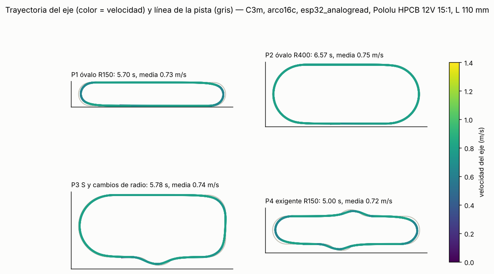
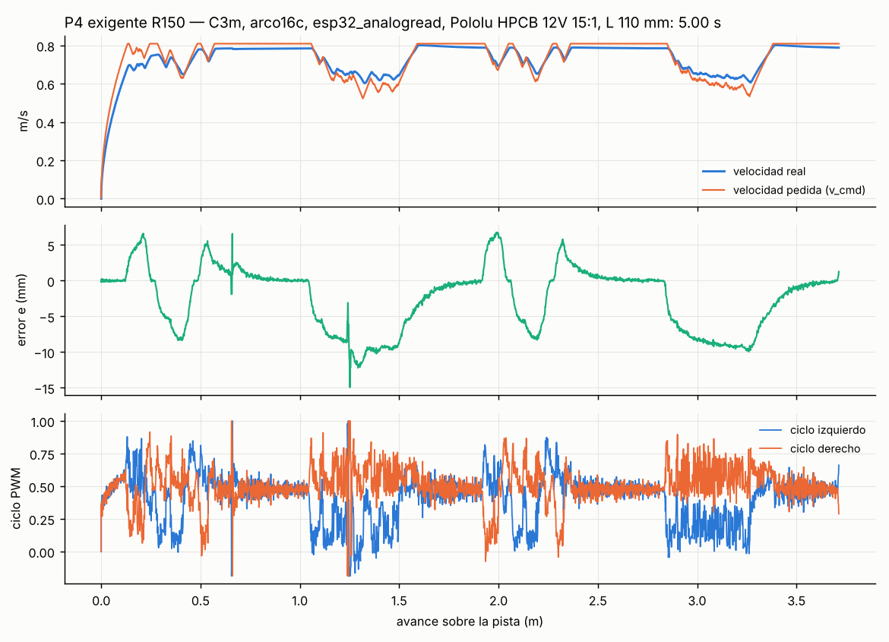
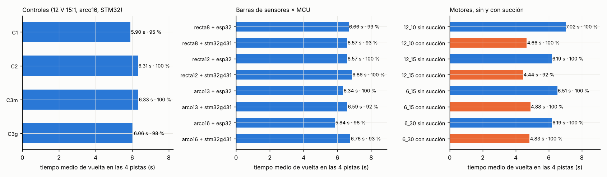
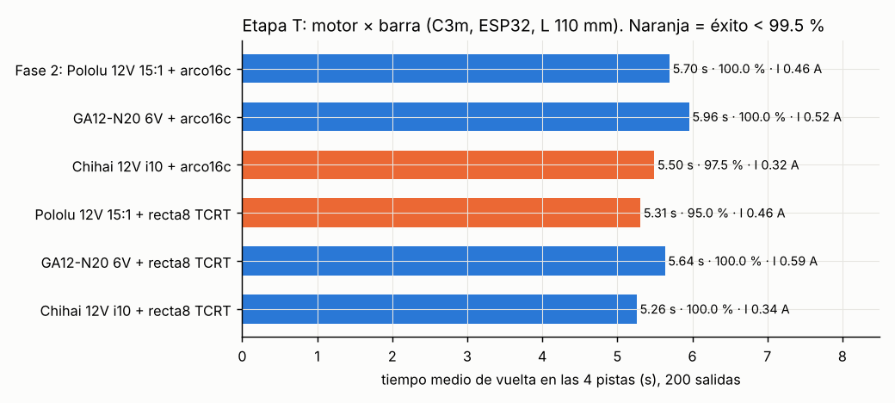
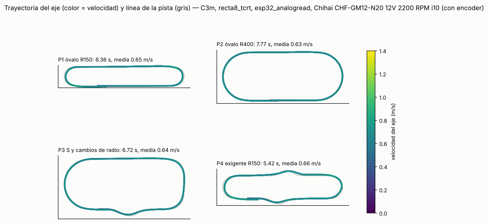
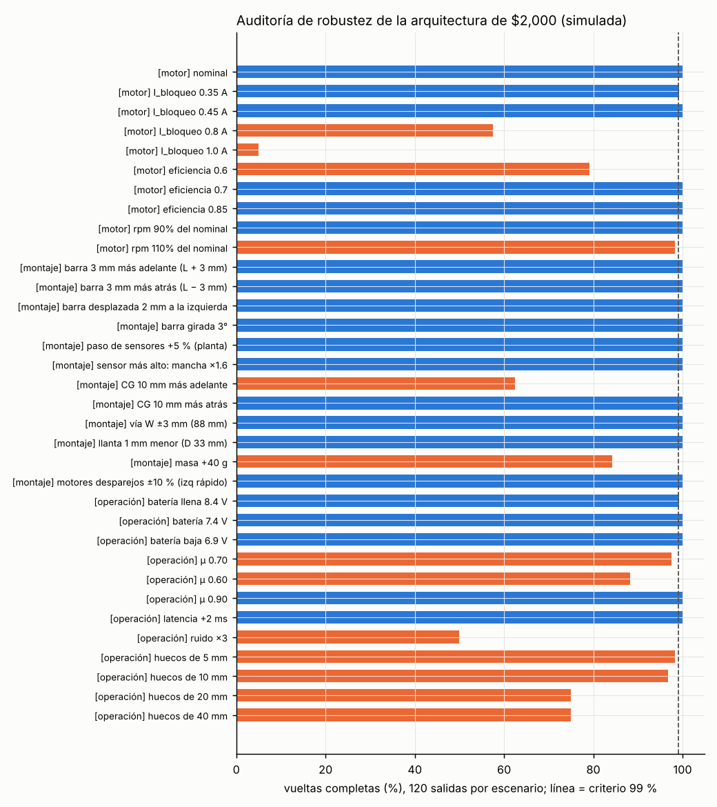

# Simulación dinámica — Fases 2, 3 y final

Fecha: 1 nov 2026 · Rama `engineering/speed-follower`.
Etiquetas: **[Simulado]** sale del simulador dinámico · **[Calculado]** · **[Supuesto]** · **[Pendiente de medición]**. Nada de esto se ha probado en hardware.

## 1. Qué modela

| Bloque | Modelo | Archivo |
|---|---|---|
| Cuerpo | Rígido plano (x, y, guiñada) con el CG en (x_cg, h_cg), calculado de los componentes del YAML; inercia de guiñada de masas puntuales + placa | `sim/nucleo.py`, `sim/config.py` |
| Llantas | Fricción de Coulomb regularizada: F = −μ(s)·N·s/√(\|s\|² + ε²), con s la velocidad de deslizamiento del punto de contacto (longitudinal y lateral). La fuerza de cada llanta nunca supera μ·N, de modo que el **círculo de fricción** sale del modelo, no se impone aparte. μ(s) baja del estático al **cinético** (0.8·μ, supuesto) cuando la llanta desliza (μ_k + (μ − μ_k)·e^(−\|s\|/0.05)) | `nucleo.simular` |
| Apoyo | Bola: solo resistencia a la rodadura, sin fuerza lateral ni de frenado | `nucleo.simular` |
| Cargas normales | Estática + transferencia longitudinal (m·a_x·h/b) y lateral (m·a_y·h/W). Si una carga se vuelve negativa, la corrida se marca como **vuelco** | `nucleo.simular` |
| Ruedas | J·dω/dt = T_motor − F_x·r, con J = J_rotor·G² + J_llanta (la inercia del rotor reflejada, que la Fase 1 omitía) | `nucleo.simular` |
| Motor | DC lineal con los datos del fabricante (R, Ke, Kt, I₀), PWM con decaimiento lento (V = d·V_bus), corriente pico y conteo de disparos de la protección (OCP ≥ 2 A) | `nucleo.simular` |
| Batería | V_bus = V_oc − R_int·I_bus, con I_bus = Σ d·I_motor + I_lógica (+ ventilador). Integra mAh y energía | `nucleo.simular` |
| Sensores | Posición real de cada sensor (barra recta o en arco), distancia a la línea, mancha óptica de 3 mm, ruido gaussiano, huecos de 5 mm, umbral y estimación **idénticos al firmware** (`estimar_coord`) | `nucleo.simular` |
| Tiempo real | Periodo de control = max(1 ms, tiempo de lectura + cálculo); la salida se aplica tras la lectura (latencia). Tiempo de lectura = 2·(n·t_canal + t_emisor) + t_cálculo (resta de luz ambiente) | `config.construir` |
| Control | C1: PD directo sobre el ciclo · C2: perfil por curvatura 2e/L², feed-forward del motor, persecución pura, PD y **piso** (ciclo mínimo de la rueda interior, ≤ 0) · C3m: C2 + curvatura estimada con el modelo del motor a partir de la última salida (**vigente**) · C3g: C2 + curvatura de un giroscopio (ruido y sesgo) | `nucleo.paso_sf` |
| Línea perdida | Igual al firmware: se conserva el último error y a los 0.3 s se detiene (C07) | `nucleo.simular` |
| Fallas | Barra fuera de la línea > 0.1 s fuera de un hueco, o eje a más de 12 cm de la línea → **pierde la línea**; retroceso > 5 cm → **sentido contrario**; detenido o > 15 s → **detenido/tiempo**; carga normal negativa → **vuelco**; deslizamiento de una llanta > 0.4 m/s aunque termine la vuelta → **derrape** (el modelo de llanta no es confiable ahí y en la pista real es inestable) | `nucleo.simular`, `simulador.correr` |
| Vuelta | Desde parado, con la barra sobre la línea de salida, hasta que la parte trasera cruza la meta (reglamento C04-C05) | `nucleo.simular` |

**Dispersión de cada corrida (Monte Carlo, `simulador.perturbacion_aleatoria`):** μ ±10 %; batería entre 7.6 y 8.3 V; constante de cada motor ±5 % (izquierdo y derecho por separado); colocación ±3 mm y ±2°; error de medición de batería ±2 %; ruido de sensores en cada lectura.

**Integración:** Euler semiimplícito con paso ≤ 100 µs, elegido según la rigidez de la fricción (`simulador.paso_integracion`). Una vuelta tarda 20-60 ms de cómputo.

## 2. Pruebas del simulador (ejecutadas)

`python3 sim/pruebas/test_fisica.py` compara la planta contra soluciones analíticas. Valores con la configuración de la Fase 2 (12 V 15:1); la prueba se ejecuta con la configuración vigente en cada corrida de `pruebas/ejecutar_todo.sh` y pasa:

| Prueba | Simulado | Referencia | Error |
|---|---|---|---|
| Velocidad final en recta, ciclo 1.0 | 2.1901 m/s | 2.1906 m/s (equilibrio motor-rodadura-batería) | 0.02 % |
| Velocidad final en recta, ciclo 0.5 | 0.8519 m/s | 0.8524 m/s | 0.06 % |
| Aceleración máxima desde parado | 5.33 m/s² | ≤ 6.71 m/s² (agarre con transferencia hacia las ruedas) | cumple |
| ω_z = (v_R − v_L)/W en círculo | 2.269 rad/s | 2.212 rad/s | 2.6 % (deslizamiento regularizado, ε = 0.02 m/s) |
| Radio del eje = v/ω | 241.1 mm | 241.1 mm | 0.01 % |
| \|a\| del CG en giro forzado (percentil 99) | 4.54 m/s² | ≤ 8.00 m/s² (μ·g + rodadura) | cumple |
| Frenado con inverso (ruedas bloqueadas, μ cinético) | 3.89 m/s² | ≤ 4.86 m/s² (agarre estático con transferencia hacia el apoyo) | cumple |
| Energía de la batería ≥ energía cinética | 4.37 J | ≥ 0.39 J | cumple |
| Regresión: latencia = periodo (ESP32, 16 y 12 canales) | la salida cambia en 3405/3408 y 4361/4363 ciclos | > 50 % | cumple |

`python3 sim/pruebas/test_control.py`: el C2 del simulador reproduce los vectores dorados del firmware con una diferencia máxima de **5.7 × 10⁻⁸**. `pruebas/sf/ejecutar.sh`: el C++ del firmware reproduce al simulador en C2, C3m y C3g (≤ 5.6 × 10⁻⁵, diferencia entre float y double) y en `estimar_coord` (6.9 × 10⁻⁹ m).

**Efecto que la Fase 1 no capturaba:** con el CG delante del eje y un apoyo que no da fuerza lateral, girar exige una diferencia de fuerza longitudinal entre ruedas. Con ciclos fijos de 0.30/0.45, el robot describe un círculo de 241 mm, con la rueda interior arrastrada 121 mm/s por encima de su velocidad libre. El control en lazo cerrado lo compensa, pero la respuesta de guiñada es más lenta que la cinemática.

**Errores del simulador encontrados y corregidos durante la Fase 2** (cada uno con prueba de regresión o archivo de evidencia):
1. Con latencia ≥ periodo (ESP32 + 16 canales), la salida nueva sobrescribía a la pendiente y el robot no arrancaba. Corregido: el MCU aplica la salida anterior al terminar cada lectura. Prueba 9 de `test_fisica.py`.
2. **Ronda 1** (`resultados/fase2/ronda1_sin_piso/`): sin ciclo negativo en la rueda interior, la autoridad de giro a ~1.2 m/s dependía del deslizamiento de la llanta; con más agarre (succión o μ alto) el robot perdía la curva R150. Se agregó el parámetro `piso` (sim y firmware).
3. **Ronda 2** (`resultados/fase2/ronda2_sin_friccion_cinetica/`): el optimizador encontró parámetros que **bloqueaban la rueda interior y derrapaban** en R150 (deriva ≈ 40°, eje 0.69 m/s de lado). Solo funcionaba porque el modelo usaba μ estático al deslizar. Se agregó μ cinético y el criterio de derrape; todo se repitió (**ronda 3**, vigente).

## 3. Resultados de la Fase 2 (ronda 3; arquitectura anterior, ver §5 para la vigente)

Criterio: **tiempo esperado por intento** E = p·t + (1 − p)·300 s (un intento perdido vale 5 min, reglamento C07), promedio de las 4 pistas. Dispersión normal en cada corrida (§1). Cada arquitectura se ajustó con la misma búsqueda (96 candidatos al azar + 48 de refinamiento, semillas comunes) y se validó con 60 salidas nuevas; las finalistas, con 200. Los tiempos son de una vuelta **desde parado**. Velocidad media = largo de la línea / tiempo.

**Etapa A — controles** (12 V 15:1, arco16, STM32, L 100 mm; `A_controles.csv`):

| Control | Éxito | t medio | Nota |
|---|---|---|---|
| C1 PD directo | 95 % | 5.90 s | 3 derrapes |
| C2 | 100 % | 6.31 s | |
| C3m | 100 % | 6.33 s | |
| C3g (giroscopio) | 98 % | 6.06 s | 1 derrape |

La búsqueda tiene varianza: repetida con otras semillas (`E_repetibilidad_ajuste.csv`), C2 dio 6.05 y 5.98 s (una con 97 % de éxito) y C3m dio 5.78 y 5.61 s (ambas 100 %). La diferencia entre controles se decidió al final con el hardware definitivo y 200 salidas (`E_C2_vs_C3m_final.csv`): **C3m 5.76 s contra C2 6.35 s, ambos 100 %**.

**Etapa B — barra × MCU** (C2, 12 V 15:1, L 100 mm; `B_barras_mcu.csv`):

| Barra | ESP32 (analogRead) | STM32G431 |
|---|---|---|
| Recta 8 (QTR-8A, 66.7 mm) | 93 %, 6.66 s (T = 1.22 ms) | 93 %, 6.57 s (T = 1.00 ms) |
| Recta 12 (88 mm) | 100 %, 6.57 s (1.70 ms) | 100 %, 6.86 s |
| Arco 13 (paso 8 mm) | 100 %, 6.34 s (1.82 ms) | 92 %, 6.59 s |
| Arco 16 (paso 6.35 mm) | 98 %, 5.84 s (2.18 ms) | 93 %, 6.76 s |

A estas velocidades (< 1 m/s) la latencia de 2.2 ms del ESP32 **no** empeora el resultado: la barra avanza ≈ 2 mm por ciclo. Las diferencias entre MCU están dentro de la varianza de la búsqueda.

**Etapa C — motores, sin y con succión** (C2, arco13, ESP32, L 100 mm; `C_motores_succion.csv`):

| Motor | Sin succión | Con 100 gf de succión | Corriente pico por motor |
|---|---|---|---|
| 12 V 10:1 | 100 %, 7.02 s | 100 %, 4.66 s | 0.46-0.48 A |
| **12 V 15:1** | **100 %, 6.19 s** | 92 %, 4.44 s | 0.42-0.48 A |
| 6 V 15:1 (PWM ≤ 6 V) | 100 %, 6.52 s | 100 %, 4.88 s | 1.28-1.38 A |
| 6 V 30:1 (PWM ≤ 6 V) | 100 %, 6.19 s | 100 %, 4.83 s | 1.05-1.46 A |

Sin succión, el 12 V 15:1 empata con el mejor y demanda un tercio de la corriente.

**Etapa D — cuello** (C2, arco13, ESP32, 12 V 15:1; `D_cuello.csv`, `F8_cuello_dinamico.png`):

| L | 80 mm | 90 mm | 100 mm | **110 mm** | 120 mm |
|---|---|---|---|---|---|
| Éxito, t | 100 %, 6.94 s | 87 %, 6.67 s | 100 %, 6.34 s | **100 %, 6.19 s** | 100 %, 6.66 s |

El criterio geométrico de la Fase 1 (barra en arco: captura hasta 100 mm en el peor caso) resultó **conservador**: el control empieza a girar antes de que la línea llegue a ese desplazamiento, y 110 mm captura sin fallas.

**Etapa F — finalistas** (C2, 12 V 15:1; barra × MCU × L, 200 salidas por finalista; `F_finalistas.csv`, `E_cara_a_cara.csv`):

| Finalista | Éxito (IC 95 %) | t medio |
|---|---|---|
| **Arco16 + ESP32 + L110** | **100 % (98.1-100)** | **6.29 s** |
| Arco13 + ESP32 + L110 | 99.5 % (97.2-99.9) | 6.19 s |
| Arco13 + ESP32 + L100 | 100 % (98.1-100) | 6.34 s |
| Arco13 + STM32 + L110 | 99.5 % | 6.46 s |
| Recta8 + ESP32 + L110 | 100 % | 6.79 s |
| Opción B: 12 V 10:1 con succión (parámetros de la etapa C) | 99.5 % | 4.65 s |

**Validación de la arquitectura de la Fase 2** (C3m, arco16c, ESP32, 12 V 15:1, L 110 mm; 200 salidas por escenario; `fase2/E_validacion.csv`):

| Escenario | Éxito (IC 95 %) | t medio | t percentil 95 | Fallas |
|---|---|---|---|---|
| **Nominal** | **100 % (98.1-100)** | **5.76 s** | 6.73 s | — |
| Batería baja (6.9 V) | 100 % | 5.77 s | | — |
| μ −25 % (0.6) | 80.5 % (74.5-85.4) | 5.96 s | | 39 derrapes |
| Latencia +1 ms | 100 % | 5.77 s | | — |
| Ruido de sensores ×2 | 100 % | 5.76 s | | — |
| Medición de batería +5 % | 100 % | 6.18 s | | — |

Por pista (nominal): P1 5.70 s, P2 6.57 s, P3 5.78 s, P4 5.00 s; velocidad media 0.73 m/s; corriente pico 0.43 A por motor; 0.33 mAh por vuelta; batería mínima 7.51 V.

**La velocidad máxima depende del agarre real** (`E_perfil_por_mu.csv`, C3m con a_lat proporcional a μ):

| μ medido | v_max con 100 % de éxito (30 salidas × 4 pistas) | t medio |
|---|---|---|
| 0.8 | 0.81 m/s | 5.76 s |
| 0.7 | 0.77 m/s | 6.06 s |
| 0.6 | 0.73 m/s | 6.40 s |
| 0.5 | 0.65 m/s | 7.14 s |

**Perfil por radio mínimo** (`E_perfil_por_radio.csv`): si el equipo ve la pista antes de su intento, puede subir v_max por consola. Con R mínimo de 150 mm, 0.8 m/s; con 200 mm, 0.9 m/s (P3: 5.36 s, −7 %); con 400 mm, 1.2 m/s (P2: 5.06 s, −23 %). Siempre con μ = 0.8 y sin probar en hardware.

**Por qué es lento comparado con la Fase 1** (cota de 3.0-3.4 s): el robot solo ve la curva a L = 11 cm, frena con ≤ 3.9 m/s² cuando la llanta desliza, y en R150 el agarre cinético no alcanza para recuperar un derrape. La velocidad máxima segura en recta queda acotada por v ≈ √(v_curva² + 2·a_freno·L). La succión sube a la vez v_curva y a_freno, y por eso es la palanca más grande (−22 a −34 % en la etapa C).

## 4. Limitaciones

1. Motor lineal con datos de bloqueo extrapolados por el fabricante; sin inductancia (τ ≈ 60 µs), temperatura ni holgura de la reductora. J_rotor es un supuesto (Pololu no lo publica).
2. Fricción de Coulomb regularizada con μ estático y cinético supuestos (0.8 y 0.64) y sin rigidez lateral real de la llanta. **μ y μ cinético son los supuestos dominantes** y deben medirse (M1): con μ −25 % el éxito baja a 80 %.
3. Sensores: la mancha óptica, el ruido y el tiempo por canal son supuestos o mediciones de terceros. Las lecturas de un ciclo se toman en el mismo instante; en el MCU real cada canal se lee en un momento distinto.
4. Pistas sintéticas; superficie plana y uniforme; sin uniones entre placas ni polvo.
5. Sin rizado de PWM, sin flexión del chasis, sin golpes del rival (final).
6. Los criterios de falla son una interpretación del reglamento: el referee decide qué es "perder la pista". El umbral de derrape (0.4 m/s) es una decisión de diseño.
7. Los ciclos de PWM oscilan rápido (F6): en el robot real eso significa ruido eléctrico y calor en el driver, a revisar en pruebas.
8. La búsqueda de parámetros tiene varianza (≈ ±5 % en tiempo): las diferencias menores a eso entre arquitecturas no son significativas.

## 5. Fase 3: arquitectura de $2,000 MXN

La planta es la misma (no se cambió el modelo físico). Cambian los datos de la configuración maestra: motores Chihai N20 12 V i10 y GA12-N20 6 V con par estimado por **T = η·Ke·(I_bl − I0)**, η = 0.79 deducida de la ficha Pololu (el supuesto anterior del GA12 implicaba η = 1.56, imposible); masa del motor con encoder; barra clon de 8 TCRT5000 con mancha de 5 mm, ruido 0.04 y **sin resta de luz ambiente** (ciclo de 1.0 ms: 8 × 75 µs + 60 µs); ESP32 con 75 µs por canal (60 de analogRead + 15 de establecimiento del mux); masa y CG de la disposición definitiva (132 g, CG a 22.4 mm, f_motriz 0.72). Resultados en `sim/resultados/fase3/`.

**Etapa T — motor × barra** (C3m, ESP32, L 110 mm; ajuste igual para todos; 200 salidas; disposición previa de 121-126 g; `T_candidatos.csv`, `F1_candidatos.png`):

| Candidato | Éxito | t medio | I pico |
|---|---|---|---|
| Chihai 12 V i10 + recta8 TCRT | 100 % | **5.26 s** | 0.34 A |
| Pololu 12 V 15:1 + recta8 TCRT | 95 % | 5.31 s | 0.46 A |
| Chihai 12 V i10 + arco16c | 97.5 % | 5.50 s | 0.32 A |
| GA12-N20 6 V + recta8 TCRT | 100 % | 5.64 s | 0.59 A |
| Pololu 12 V 15:1 + arco16c (Fase 2) | 100 % | 5.70 s | 0.46 A |
| GA12-N20 6 V + arco16c | 100 % | 5.96 s | 0.52 A |

**Ajuste final sobre la disposición definitiva:** con la masa real (ESP32 de 11 g, motores con encoder), los parámetros de la etapa T bajan a 92 % (16 derrapes en 200) y un reajuste normal da 97.5 % (`G_T_vs_G.csv`). El ajuste estaba en el borde del criterio de derrape, así que se reajustó **con margen** (deslizamiento máximo de 0.30 m/s durante la búsqueda, validación con 0.40 m/s) y se barrió v_max (`G_barrido_vmax_robusto.csv`):

| v_max | Éxito (200) | t medio | Tiempo esperado por intento |
|---|---|---|---|
| 0.62 | 100 % | 6.59 s | 6.59 s |
| **0.66 (vigente)** | **100 %** | **6.35 s** | **6.35 s** |
| 0.70 | 99.5 % | 6.14 s | 7.6 s |
| 0.74 | 99.5 % | 5.93 s | 7.4 s |
| 0.78 | 99 % | 5.74 s | 8.7 s |

**Comparación justa con la Fase 2** (mismo ajuste robusto, misma disposición; `C_anterior_vs_nueva.csv`): Fase 2 (Pololu + arco16c) 6.22 s y 100 %; Fase 3 6.85 s y 100 % sin barrido, 6.35 s con v_max 0.66. Robustez: ver [AUDITORIA_ROBUSTEZ.md](AUDITORIA_ROBUSTEZ.md).

## 6. Fase final: configuración definitiva (`sim/fase_final.py`, `sim/resultados/final/`)

**Cambios del modelo** (la física de la planta es la misma de la Fase 2):
- Masa, CG e inercia desde `componentes` del YAML, que ahora copia masas y posiciones del **CAD** (113.0 g, x_CG 20.1 mm,
  h_CG 15.4 mm, f_motriz 0.78; `hardware/mechanical/verificar_mecanica.py --actualizar-yaml`).
- Barra `arco16q`: 16 QRE1113GR en arco de radio L = 110 mm, paso 5.9 mm, **con resta de luz ambiente**: la lectura dura
  2 barridos + el establecimiento del fototransistor (t_emisor 200 µs [S]); el simulador usa 478 µs por lectura
  (conservador frente a los ≈ 225 µs del firmware con los dos ADC en paralelo).
- Encoders con **cuantización real** (12 CPR × 9.96 = 119.5 cuentas por vuelta de rueda): la velocidad medida es la
  diferencia de cuentas entre lecturas. Habilita la fuente de curvatura 3 (C3e: curvatura medida con los encoders).
- Plantas de incertidumbre del motor (J_rotor × 0.5-2, bloqueo × 0.8-1.2, μ 0.7) para elegir controles que no dependan
  del valor exacto de los datos que el fabricante no publica.

**Etapas:**

| Etapa | Qué hace | Resultado |
|---|---|---|
| Z | Ajuste de C3m para cada motor candidato (200 salidas) | Pololu 10:1: 5.39 s; 15:1: 5.56 s; Chihai i10: 5.03 s con datos supuestos |
| R | Sensibilidad de cada motor a sus datos no publicados | Chihai: 75 % con bloqueo de 0.8 A; 15:1: 70.8 % con J_rotor × 0.5; 10:1: 90 % con J_rotor × 0.5 |
| E | Ajuste robusto de C3m (curvatura del modelo) y C3e (de los encoders) sobre 8 plantas; barrido de v_max | `E_fuente_curvatura.csv` |
| S | Elección por tiempo esperado medio sobre 6 plantas | **C3m v_max 0.8165** (5.81 s nominal, peor caso 98.3 %); **modo seguro C3e v_max 0.6327** (7.16 s, 100 % en las 6) |
| F | Validación del control de competencia con 17 escenarios (masas del CAD) | 100 % nominal (200 salidas, 5.81 s); único caso bajo el criterio: CG 10 mm adelante (80 %) |
| G | Modo seguro con las masas del CAD y tolerancia de CG de ambos controles | `G_modo_seguro.csv` (resumen en `VALIDACION_FINAL.md` §3) |

Robustez completa: [AUDITORIA_ROBUSTEZ.md](AUDITORIA_ROBUSTEZ.md). Comparación firmware = simulador (C2, C3m, C3g, C3e y
estimación de la línea): diferencia ≤ 4.3 × 10⁻⁶ (`pruebas/ejecutar_todo.sh`, paso 4).
