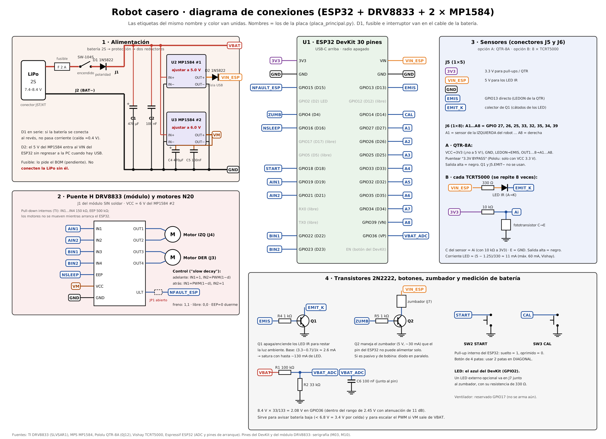
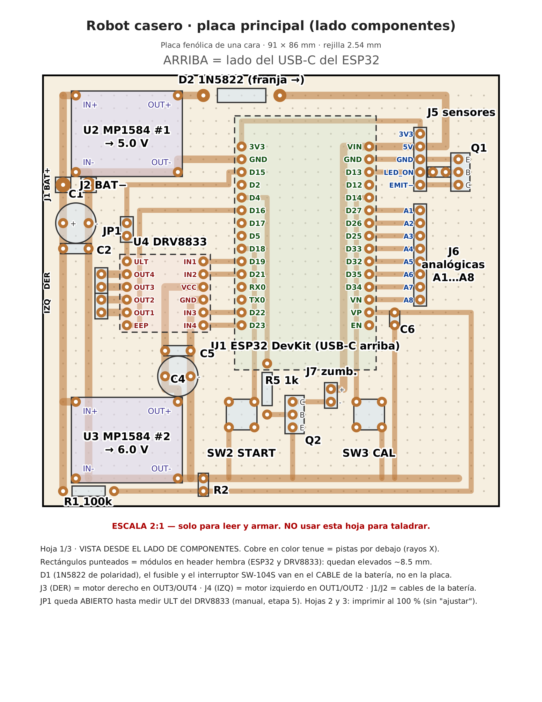

# Robot casero · A. Diagrama de conexiones

Plan B (prototipo oficial para la competencia). Este diagrama usa solo lo que ya está en la mesa: ESP32 DevKit de 30 pines, módulo DRV8833, 2 × MP1584, 1N5822, 2N2222, botones, interruptor SW-104S y placa fenólica. **No hay PCB fabricada ni piezas impresas.**



Versión para imprimir: [`diagrama_conexiones.pdf`](diagrama_conexiones.pdf). Lo genera `herramientas/diagrama_conexiones.py`, que además comprueba que cada pin del ESP32 coincide con la placa.

**Marcas que se usan en este documento:**

| Marca | Significado |
|---|---|
| **[V]** | Verificado documentalmente (hoja de datos o serigrafía) |
| **[C]** | Calculado |
| **[E]** | Estimado |
| **[S]** | Simulado |
| **[P]** | Pendiente de medición física |

## 1. Alimentación

```
LiPo 2S ─ fusible 2 A ─ SW-104S ─ D1 1N5822 ─┬─ J1 (VBAT) ─┬─ C1 470 µF + C2 100 nF
(7.4–8.4 V)                                  │             ├─ U2 MP1584 #1 → 5.0 V ─ D2 1N5822 ─ VIN del ESP32 (VIN_ESP)
                                             │             ├─ U3 MP1584 #2 → 6.0 V ─ VM: VCC del DRV8833 + C4 470 µF + C5 100 nF
LiPo − ──────────────────────────────────────┴─ J2 (GND)   └─ R1 100 kΩ / R2 33 kΩ → GPIO36 (con C6 100 nF)
```

| Pieza | Para qué está | Datos |
|---|---|---|
| **D1 1N5822, en el cable de la batería** | **Protección de polaridad.** Si la batería se conecta al revés, el diodo no conduce y no se quema nada. Va en el cable, no en la placa. Sus patas de 1.3 mm no entran en la broca de 0.8 mm, y así queda junto al interruptor. | 40 V, 3 A, VF ≤ 0.525 V a 3 A, patas de Ø1.30 mm [V ST 1N5821-22]. Caída a ~0.5 A: ≈ 0.35 V [E]. Se mide en la etapa 6 del manual. |
| **D2 1N5822, en la placa** | **Aislamiento USB / batería.** El 5 V del MP1584 entra al VIN del ESP32 a través de D2. Si además hay USB conectado, el 5 V de la PC no se mete al MP1584 y el MP1584 no empuja corriente hacia la PC. | VIN queda en ≈ 4.7 V [E]. Es suficiente para el regulador de 3.3 V del DevKit con ~150 mA. |
| U2 MP1584 #1 | 5.0 V para el ESP32, los LED IR de los sensores y el zumbador. | **Ajustar ANTES de soldar** (E01). |
| U3 MP1584 #2 | 6.0 V fijos para los motores (decisión D04 de Alan). El N20 es de 6 V. Con VM constante, el PID se comporta igual con la batería llena que casi vacía. | **Ajustar ANTES de soldar** (E02). Si se cae con carga, ver el plan B de la sección 3. |
| Fusible 2 A (BOM, pendiente) | Un corto en VBAT–GND sin fusible deja la LiPo en corto. | **No conecten la LiPo sin fusible.** |
| R1/R2 + C6 | Medir la batería: 8.4 V × 33/133 = **2.08 V** en GPIO36 [C]. Está dentro del rango de 150–2450 mV del ADC con atenuación de 11 dB [V Espressif]. | El firmware suma la caída de D1 (`caida_d1`). Avisa batería baja en < 6.8 V y se detiene en < 6.4 V. |

## 2. Señales del ESP32

ESP32 visto desde arriba, con el USB-C hacia arriba (orden de serigrafía, M03).

| GPIO | Pin DevKit | Va a | Notas |
|---|---|---|---|
| 19 / 21 | D19 / D21 | DRV8833 IN1 / IN2 → **motor IZQUIERDO** (OUT1/OUT2, J4) | PWM de 20 kHz. Decaimiento lento: adelante IN1 = 1, IN2 = PWM [V TI, tabla 2]. |
| 22 / 23 | D22 / D23 | DRV8833 IN3 / IN4 → **motor DERECHO** (OUT3/OUT4, J3) | Quedan en línea recta con el módulo girado 180°. |
| 16 | D16 | DRV8833 EEP (nSLEEP) | Pull-down interno de 500 kΩ [V]: el puente duerme mientras arranca el ESP32. Las entradas IN tienen 150 kΩ [V]. |
| 15 | D15 | DRV8833 ULT (nFAULT) **a través de JP1** | JP1 queda **abierto** hasta medir que ULT no trae más de 3.3 V. El módulo podría tener un pull-up a VM (6 V) y quemaría el pin [P]. |
| 18 | D18 | Botón **START** a GND | Pull-up interno. Alan usaba GPIO4; se cambió para que la placa no lleve puentes. |
| 14 | D14 | Botón **CAL** a GND | Pull-up interno. |
| 4 | D4 | Base de **Q2** por R5 1 kΩ → zumbador | Q2: 2N2222. |
| 13 | D13 | Base de **Q1** por R4 1 kΩ (TCRT5000) y LEDON de la QTR-8A | Alto = LED IR encendidos. |
| 27, 26, 25, 33, 32, 35, 34, 39 | J6 A1…A8 | Salidas de los 8 sensores, de **izquierda a derecha** | 25/26/27 son ADC2: funcionan porque el radio nunca se enciende [V Espressif]. |
| 36 | VP | Divisor de batería | Solo entrada. |
| 2 | D2 | LED azul del DevKit | Indicador de estado. |
| 5, 12, 17 | — | Libres | 17 queda reservado al ventilador. 12 es pin de arranque: no conectarle nada. |
| EN | EN | Botón EN del DevKit | Se usa el botón que ya trae el DevKit; no hace falta botón de RESET en la placa. |

**Cambios respecto a `pines_robot_casero.h` de Alan:**

- START pasa de GPIO4 a GPIO18 y el zumbador queda en GPIO4. Así la placa se rutea sin puentes.
- Se agregó nFAULT en GPIO15, con JP1.
- Ya no hay pull-down externo de 10 kΩ en nSLEEP, porque el chip trae uno de 500 kΩ [V].

El multiplexor sigue en los mismos pines de Alan, por si se usa: S0 = 25, S1 = 26, S2 = 27, S3 = 33 y SIG = 34.

## 3. 2N2222: por qué y cómo

Datos del P2N2222A de onsemi [V]: IC hasta 600 mA, VCEO 40 V, hFE ≥ 100 a 150 mA y VCE(sat) ≤ 0.3 V a 150 mA/15 mA.

**Ojo con el orden de las patas:**

- El P2N2222A de onsemi es **C-B-E** [V].
- Otros fabricantes usan **E-B-C**. El de ustedes ("H331") no se sabe, así que se mide (P05). La pata del centro siempre es la base.

| Transistor | Función | Cálculo |
|---|---|---|
| **Q1** | Interruptor del lado bajo de los LED IR de los TCRT5000. Se prenden y se apagan en cada lectura para **restar la luz del lugar**: el firmware lee con LED encendidos y apagados y resta. Con la QTR-8A no se usa, porque esa barra tiene su propio LEDON. | Base: (3.3 − 0.8)/1 kΩ ≈ 2.5 mA. Con 8 sensores a ~11 mA son 90 mA, β forzada ≈ 36 < 100: satura [C]. |
| **Q2** | Maneja el zumbador. Un zumbador de 5 V pide ~30 mA, y el pin del ESP32 es de 3.3 V y no debe dar tanto. | Base 2.5 mA. Si el zumbador es **pasivo de bobina**, lleva un diodo en paralelo con el cátodo a +5 V [P: tipo de zumbador]. |

## 4. Sensores (conectores J5 y J6)

| J5 | Señal | J6 | GPIO |
|---|---|---|---|
| 1 | 3V3 (pull-ups y QTR-8A) | A1 … A8 | 27, 26, 25, 33, 32, 35, 34, 39 |
| 2 | 5 V (VIN_ESP, LED IR) | | |
| 3 | GND | | |
| 4 | LED_ON (GPIO13 directo) | | |
| 5 | EMIT− (colector de Q1) | | |

### Opción A · QTR-8A

| Pin de la QTR | Va a |
|---|---|
| VCC | 3V3. **No a 5 V:** la salida llega hasta VCC y el ESP32 no aguanta 5 V. |
| GND | GND |
| LEDON | J5.4 |
| OUT1…8 | A1…A8 |

Hay que **puentear "3.3V BYPASS"**. Pololu indica cortocircuitarlo solo cuando VCC es de 3.3 V, nunca con 5 V [V Pololu 0J12]. La salida tiende a VCC sobre negro y a 0 V sobre blanco [V Pololu].

### Opción B · 8 TCRT5000 sueltos

Cada sensor lleva:

| Elemento | Conexión |
|---|---|
| LED IR | 5 V → 330 Ω → A, y K → EMIT− |
| Fototransistor | C → Ai, con 10 kΩ de Ai a 3V3 |
| Emisor | E → GND |

Corriente del LED ≈ (5 − 1.25)/330 ≈ 11 mA [C]. El máximo es 60 mA y el VF típico 1.25 V [V Vishay]. La mejor distancia al piso es 2.5 mm, con rango útil de 0.2 a 15 mm [V Vishay].

**Pendiente [P] (M19):** el orden físico de las 4 patas. Pongan el sensor sobre papel, marquen las patas y midan el LED en modo diodo: ~1.1 V en directa.

### Opción C · 12 TCRT5000 + 74HC4067 (D05 de Alan)

En `config.h` se pone `SENSORES_DIRECTOS 0`. El cableado del multiplexor sigue la tabla de la sección 2.

## 5. Cómo se reparte la placa principal



La idea es que cada zona quede pegada a lo que conecta, para que las pistas sean cortas y no se crucen:

| Zona | Qué va | Por qué ahí |
|---|---|---|
| **Orilla izquierda** | Rieles VBAT (columna 0) y GND (columna 2), con **una columna vacía en medio** para que una gota de soldadura no ponga la batería en corto. Ahí entran los cables de la batería (J1/J2), C1/C2 y los cables de los motores (J3/J4). | El lado izquierdo del dibujo va hacia atrás del robot, donde están los motores. |
| **Esquinas izquierdas** | U2 (5 V) arriba y U3 (6 V) abajo, pegados con cinta doble cara. | Toman VBAT directo del riel izquierdo. |
| **Centro izquierda** | DRV8833 girado 180°: sus entradas IN1…IN4 quedan **en línea recta** con D19, D21, D22 y D23 del ESP32. VCC y GND salen por debajo del módulo. C4/C5 van abajo, junto a U3. | Pistas de control rectas; potencia de motor corta. |
| **Centro** | ESP32 en 2 tiras de header hembra 1×15, con el USB-C hacia la orilla de arriba (accesible para programar). Por debajo del DevKit pasan 3 pistas, por el lado del cobre. | Es el que conecta con todo. |
| **Derecha** | J5 (1×5) y J6 (1×8) de los sensores, frente a los pines analógicos (rectas de 3 agujeros), y Q1 con R4. | Las salidas analógicas de los sensores están todas en la fila derecha del DevKit. Esta orilla va al frente, hacia la barra de sensores. |
| **Abajo** | Botones START y CAL, zumbador (J7) con Q2/R5, divisor de batería (R1/R2) y bus de GND. | Botones a la mano; el divisor junto al riel de VBAT. |

La placa mide **91 × 86 mm**, tiene 107 agujeros y **cero puentes de alambre**. El detalle de pistas y del armado está en [`LAYOUT_PLACA.md`](LAYOUT_PLACA.md) y en el [manual de ensamblaje](MANUAL_ENSAMBLAJE.md).

## Fuentes consultadas

- TI DRV8833 (SLVSAR1E): tablas de control, pull-downs, nFAULT de drenador abierto, IOCP ≥ 2 A, VM 2.7–10.8 V. https://www.ti.com/document-viewer/DRV8833/datasheet
- Pololu QTR-8A, guía 0J12: 3.3V BYPASS, LEDON y polaridad de la salida. https://www.pololu.com/docs/0j12/5
- Vishay TCRT5000: corriente y VF del LED, distancia de trabajo. https://www.epfl.ch/campus/associations/robopoly/wp-content/uploads/2018/09/TCRT5000.pdf
- onsemi P2N2222A. https://www.onsemi.com/pdf/datasheet/p2n2222a-d.pdf
- ST 1N5820/21/22. https://www.st.com/resource/en/datasheet/1n5821.pdf
- Espressif, ADC del ESP32 (rangos por atenuación, ADC2 y Wi-Fi). https://docs.espressif.com/projects/esp-idf/en/v4.4.3/esp32/api-reference/peripherals/adc.html
