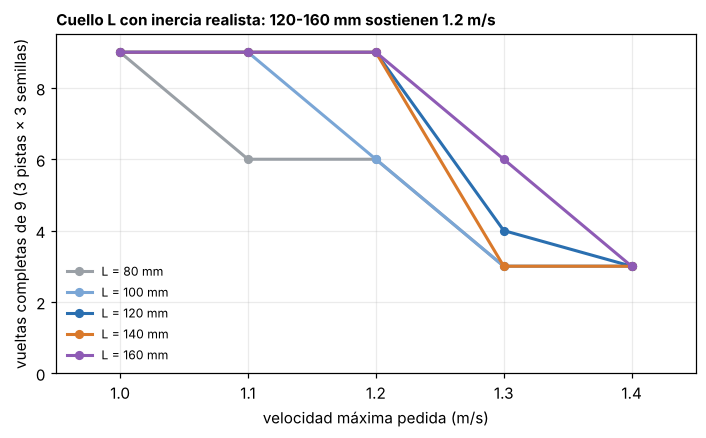

# Speed Follower — Entregable 1: Arquitectura (para aprobación)

Fecha: 31 oct 2026 · Rama `engineering/speed-follower` (creada desde `engineering/final-prototype`).
**Estado: propuesta, no aprobada.** No hay KiCad, STL, BOM de compra ni firmware C++ nuevo: llegan en el entregable 2, después de tu aprobación.

Etiquetas: **[Doc]** ficha o página oficial · **[Cálc]** cálculo · **[Sim]** simulador Python de esta rama · **[Sup]** supuesto · **[MEDIR]** medición pendiente.
Reproducir todo: `cd speed-follower/sim && python3 fase1_calculos.py && python3 barridos_fase1.py && python3 robustez.py && python3 cuello_inercia.py && python3 graficas.py`.

## 0. Verificación de realidad

| Punto | Resultado | Fuente |
|---|---|---|
| Fecha | **Sábado 21 de noviembre de 2026**, 8:00-16:00, Tec Campus León. El "23 de noviembre" solo aparece en el contexto inicial del proyecto (era un error) | Convocatoria oficial (profcduquetec.github.io) [Doc] |
| Registro | La convocatoria dice **2 de noviembre** (punto 6) y **17 de noviembre 18:00** (punto 10); ella misma marca la inconsistencia | [Doc]. El equipo dijo estar inscrito: confirmar, porque el 2 de noviembre es mañana |
| Dimensiones y peso | **20 cm de largo × 10 cm de ancho, sin límite de altura; 500 g en todo momento**; sin extensiones después de arrancar | Reglamento entregado por el equipo [Doc]. La página web del reglamento no cargó al consultarla |
| Pista | Fórmica blanca mate en MDF de 1.22 × 2.44 m; vinil negro de 2.5 cm; curvas < 90° con R > 15 cm; U permitidas; huecos ≤ 5 mm; líneas a ≥ 20 cm; sin cruces; varios circuitos posibles | Reglamento [Doc] |
| KiCad e impresora 3D | Capacidades a coordinar, sin tiempos confirmados | Equipo [Sup] |
| Días disponibles | 21 (al 31 oct) | [Cálc] |

## 1. Requisitos derivados

| Requisito | Valor | Origen |
|---|---|---|
| R1 Huella | ≤ 200 × 100 mm, incluido el cuello y la barra | Reglamento |
| R2 Masa | ≤ 450 g de diseño (margen de 50 g); **objetivo ≤ 200 g** por rendimiento (§6) | Reglamento + [Sim] |
| R3 Curva más cerrada | R = 150 mm; con a_lat = 4 m/s², v_curva = √(4·0.15) = **0.77 m/s** | [Cálc] |
| R4 Tracción | a ≤ μ·g·f = 0.8·9.81·0.7 = **5.5 m/s²** (μ y f: [Sup], medir μ) | [Cálc] |
| R5 Recuperación | Perder la línea después del primer metro = intento perdido (5 min) | Reglamento |
| R6 Sin inversión de la rueda interior como primera respuesta | Política de control | Tu instrucción |
| R7 Lógica probable en PC | C++ puro sin Arduino | Tu instrucción |

## 2. Hallazgo principal: qué limita la velocidad

**Con control reactivo** (sin saber qué viene), la velocidad máxima no la pone el motor sino **la distancia a la que el robot ve la curva** (≈ L) **frente a la distancia que necesita para frenar**:

d_frenado = (v² − v_curva²) / (2·a_freno). Para entrar a R 150 a 0.77 m/s con freno de 4 m/s² [Cálc]:

| v en la recta | 1.0 m/s | 1.2 m/s | 1.4 m/s | 1.6 m/s | 2.0 m/s |
|---|---|---|---|---|---|
| Distancia de frenado | 50 mm | 105 mm | 170 mm | 245 mm | 425 mm |

Como L ≤ ~160 mm (la huella es de 200 mm), **el techo reactivo está alrededor de 1.2-1.4 m/s** en pistas con curvas de R 150.
- **[Sim]:** 1.2 m/s sostenido (9/9 vueltas) con L = 120-160 mm e inercia realista; 1.3-1.4 m/s falla en la pista técnica.
- **Con la pista conocida** (perfil de velocidad aprendido en el primer intento, que requiere encoders) el techo teórico sube. Vuelta ideal [Cálc, `S1`]:

| v máx. | Óvalo (5.67 m) | Técnica (3.74 m) | Serpentina (4.86 m) |
|---|---|---|---|
| 1.0 m/s | 5.77 s | 4.21 s | 5.11 s |
| 2.0 m/s | 3.89 s | 3.75 s | 3.73 s |
| 2.5 m/s | 3.77 s | 3.75 s | 3.64 s |

**Conclusión:** una velocidad objetivo de 2.5 m/s **no es alcanzable de forma reactiva** en este tablero. Arriba de 2 m/s la ganancia es casi nula incluso con mapa (rectas cortas en 2.44 m).
- **Objetivo MVP (reactivo): 1.2 m/s sostenido.**
- **Objetivo de la versión competitiva: 2.0 m/s en rectas con mapa de la pista**, solo si se compran motores con encoder (decisión SF-1).

## 3. Motores (Fase 1)

Modelo: motor DC con curva par-velocidad lineal desde la ficha. V = I·R + Ke·ω, T = Kt·(I − I0), R = Vnom/Is, Ke = (Vnom − I0·R)/ω0, Kt = Ts/(Is − I0).
Rueda de 33 mm, robot de 0.20 kg; motores de 12 V directo a la 2S (siempre bajo su nominal); motores de 6 V limitados por PWM a 6 V promedio [Cálc, `fase1_calculos.py`]:

| Motor | Fuente | v libre | I bloqueo (al voltaje aplicado) | Driver con 100 % de margen | τ mecánica | Freno a 1.2 m/s (corto / contracorriente) | v sostenible [Sim, 9/9] |
|---|---|---|---|---|---|---|---|
| **Pololu HPCB 12 V 15:1** | Pololu: 2200 RPM, 0.25 kg·cm, 0.75 A a 12 V; a 6 V 1100 RPM, 0.38 A [Doc] | 2.34 m/s | **0.53 A** (a 8.4 V) | 1.05 A | 0.26 s | 4.7 / 5.5 m/s² | **1.3** (L 140) |
| Pololu HPCB 12 V 10:1 | Pololu: 3400 RPM, 0.17 kg·cm, 0.75 A [Doc] | 3.62 m/s | 0.53 A | 1.05 A | 0.58 s | 2.1 / 5.5 | 1.1 |
| Pololu HPCB 6 V 15:1 | Pololu: 2100 RPM, 0.25 kg·cm, 1.5 A [Doc] | 3.63 m/s | 1.5 A | 3.0 A | 0.24 s | 4.9 / 5.5 | 1.2 |
| Pololu HP 6 V 10:1 | Pololu: 3100 RPM, 0.22 kg·cm, 1.6 A [Doc]. Hay uno en México a $130 ("3100 RPM 10:1 0.22 kg"), **marca no confirmada** | 5.36 m/s | 1.6 A | 3.2 A | 0.41 s | 2.9 / 5.5 | 1.1 |
| Pololu HPCB 6 V 30:1 | Pololu: 1100 RPM, 0.45 kg·cm, 1.5 A [Doc] | 1.90 m/s | 1.5 A | 3.0 A | 0.07 s | 5.5 / 5.5 | (no barrido) |
| GA12-N20 6 V 1000 RPM (UNIT) | Solo 1000 RPM, ≥ 0.15 kg·cm, I0 ≤ 0.2 A publicados [Doc]; **bloqueo y par: [Sup] 0.67 A y 0.30 kg·cm** | 1.73 m/s | **[MEDIR]** | **[MEDIR]** | 0.10 s [Sup] | 5.5 / 5.5 [Sup] | 1.4 [Sim con supuestos] |

La última columna es de `S7`: L = 140 mm, 12 sensores a 8 mm y radio de giro de 45 mm. Con la inercia realista de §5.2, el 12 V 15:1 baja a 1.2 m/s.

Lectura:
1. En modo reactivo conviene un motor **más reducido**, con más par para frenar y v libre de 2-3 m/s, no uno de 3-6 m/s. Los de 10:1 frenan peor por fuerza contraelectromotriz (2.1 m/s² en freno corto).
2. El **Pololu HPCB 12 V 15:1 en 2S directo** es el único documentado que cumple todo:
   - corre por **debajo** de su voltaje nominal, sin el problema de sobrevoltaje de C2;
   - bloqueo ≤ 0.53 A, compatible con TB6612 o DRV8833;
   - par suficiente para frenar a 4.7 m/s²;
   - existe versión con encoder (Pololu #5206/5207 para 10:1; equivalentes para 15:1).
3. El GA12-N20 local sale bien en simulación **solo porque sus datos son supuestos**; no se puede elegir sin P1. Su v libre de 1.73 m/s **impide** el modo con mapa a 2 m/s.

**Disponibilidad en México:**
- Pololu original encontrado en Sandorobotics (CDMX), el **6 V 10:1** a **$600**, con 2 piezas [Doc]. El 12 V 15:1 no se encontró con precio: **[Pendiente]** (RobotShop lo vende, internacional).
- **Riesgo de plazo alto.**

## 4. Driver

| Driver | Datos [Doc] | Con Pololu 12 V 15:1 (2 × 0.53 = 1.05 A) | Con motores de 6 V (3.0-3.2 A) |
|---|---|---|---|
| TB6612FNG | ≤ 1.0 A recomendado, 1.2 A absoluto, sin limitación de corriente; Pd 0.78 W solo IC | 1.05 A ≈ 1.0 A: **cumple con 95 % de margen**, no 100 % | No cumple |
| **DRV8833 (encapsulado PWP/RTY)** | VM 2.7-10.8 V; 1.5 A RMS, 2 A pico por puente; Rds(on) 0.36 Ω; **OCP de hardware 2-3.3 A**; regulación de corriente con resistencia de sensado; θJA 40.5 °C/W; VIH 2 V (nSLEEP 2.5 V): compatible con 3.3 V | **Cumple con 100 %** y protege por hardware | No cumple (1.5 A RMS < 3 A) |
| DRV8833 (encapsulado PW) | 0.5 A RMS | No cumple | No cumple |

**Recomendación:** DRV8833 en encapsulado PWP. El módulo de UNIT ($24) tiene encapsulado **[Pendiente de verificar al recibirlo]**; si es PW, usar TB6612. La protección contra sobrecorriente del DRV8833 es **independiente del software**, algo que el TB6612 no tiene.
Con motores de 6 V de 1.5 A haría falta un driver de ≥ 3 A por canal (DRV8833 en paralelo, uno por motor). Es una razón más para el motor de 12 V.

## 5. Cuello L y barra de sensores (Fase 2)

### 5.1 Presupuesto de tiempo [Cálc]
| Componente | 8 canales | 12 canales | 16 canales |
|---|---|---|---|
| Lectura (40 µs/canal [Sup], dos pasadas con resta de ambiente, 100 µs por cambio de emisor = 5 × 20 µs de subida de QRE1113/ITR8307 [Doc]) | 0.84 ms | 1.16 ms | 1.48 ms |
| Lo mismo a 120 µs/canal | 2.12 ms | 3.08 ms | 4.04 ms |
| Periodo de control (≥ lectura + 0.2 ms) | 1.04 ms | 1.36 ms | 1.68 ms |
| Filtro de la derivada | 4 ms | 4 ms | 4 ms |
| Respuesta mecánica (τ con el motor 15:1, lazo abierto) | 260 ms | 260 ms | 260 ms |

Anticipación t = L/v: L = 120 mm da 100 ms a 1.2 m/s. Eso cubre la electrónica (~7 ms), pero **no** la respuesta mecánica en lazo abierto. Por eso el control usa ganancia alta (empuje transitorio) y freno activo (§7).

### 5.2 Longitud del cuello [Sim con inercia J(L)]
- J(L) = 3.3·10⁻⁴ + 0.010·L² + 0.008·L²/3 kg·m² [Sup: masas estimadas en §8].

| L | J | v sostenible (9/9) |
|---|---|---|
| 80 mm | 4.1·10⁻⁴ | 1.0 m/s |
| 100 mm | 4.6·10⁻⁴ | 1.1 m/s |
| **120 mm** | 5.1·10⁻⁴ | **1.2 m/s** |
| 140 mm | 5.8·10⁻⁴ | 1.2 m/s |
| 160 mm | 6.5·10⁻⁴ | 1.2 m/s (más éxitos a 1.3) |

- **Decisión propuesta: L = 130 mm** (rango 120-140).
- Más allá no hay ganancia clara: la inercia de una barra lejana anula la anticipación.
- Además, 130 + ~10 de barra + ~30 detrás del eje = 170 mm deja margen dentro de los 200 mm.
- Se probó sin cuello rígido especial; **la rigidez del cuello es [MEDIR]**: una barra que vibra introduce ruido.

### 5.3 Barra [Sim + Cálc]
- **Ancho:**
  - Si el robot no girara nada, al entrar a R 150 la línea se desplazaría L²/(2R) en la barra: 48 mm con L = 120, 56 mm con L = 130.
  - Con 100 mm de ancho máximo (semibarra de 50 mm) **no se puede cubrir ese caso**; se cubre con control.
  - En simulación, una barra de 70 mm (8 sensores a 9.5 mm) sostiene 1.2 m/s igual que una de 91 mm (12 a 8 mm) o de 93 mm (16 a 6 mm).
- **Paso:** ≤ 12.5 mm para ver la línea de 25 mm con ≥ 2 sensores; ≤ 8.3 mm con ≥ 3. En simulación, 6 sensores a 16 mm y 8 a 12 mm fallan a 1.0 m/s.
- **Cantidad: 8-12.** Más canales no mejoraron el resultado y alargan la lectura: con 16 canales a 120 µs se pierde una pista. **No** se justifican 2 QTR-8A ni 24 canales.
- **Recomendación:**
  - **MVP:** 8 sensores con paso ~8-9.5 mm (el QTR-8A clon de UNIT, $61, sirve; su paso real es [MEDIR]).
  - **Plan A con PCB:** 12 × ITR8307 (UNIT, $9 c/u, 75 en existencia [Doc]) a 8 mm = 91 mm de ancho.
- **Altura:** depende del sensor: TCRT5000 tiene su pico a 2.5 mm [Doc]. QRE1113 e ITR8307 se especifican a 1 mm [Doc]: piden un patín bajo y plano. El clon de UNIT dice 8-12 mm [Doc del vendedor]. **[MEDIR]** con el sensor real.
- **Barra curva:** acerca los extremos a los costados del robot y ayuda en la entrada a curvas. No está modelada; queda como mejora.

## 6. Sensibilidad [Sim, `S6`, motor 12 V 10:1, v = 1.0]
| Variable | Resultado | Implicación |
|---|---|---|
| Periodo de control 1-4 ms | Sin cambio; a 8 ms falla | Basta un lazo de ≤ 4 ms |
| Ruido de sensor 3 % → 10 % | Falla una pista | Calibración y resta de ambiente obligatorias |
| Agarre μ 0.8 → 0.65 | Falla una pista | **Llantas de silicón y medir μ** (prueba de plano inclinado) |
| Masa 0.20 → 0.30 kg | Falla una pista | **Objetivo ≤ 200 g** |

## 7. Control (Fase 3, solo diseño; código C++ en el entregable 2)

Comparación en las mismas pistas [Sim, `S5`]:

| Controlador | 1.0 m/s | 1.2 m/s | Rueda interior invertida |
|---|---|---|---|
| C1: PD directo sobre PWM (prototipo anterior) | Completa, pero lento (46 s en total) | Completa (28 s) | **27 s y 14 s de inversión** |
| **C2: perfil por curvatura + FF de motor y aceleración + PD, sin inversión** | **15.7 s** | 2/3 pistas | 0 s |
| C2 + inversión de emergencia | 15.8 s | 2/3 | 0.08 s (casi no se usa) |
| C2 sin FF de aceleración | 17.6 s | 2/3 | 0 |
| C2 sin persecución pura | 15.8 s | 2/3 | 0 |

Diseño propuesto (C2):
1. **Velocidad base por curvatura**, no por error: κ̂ = 2e/L² filtrada; v_obj = min(v_max, √(a_lat/|κ̂|)); rampa a_lon.
2. **Diferencia de velocidades controlada**: v_L = v + Δ/2, v_R = v − Δ/2. Δ = FF de persecución pura (2·v·e·W/L²) + PD (Kp·e + Kd·ė).
3. **Feed-forward de motor** (sin encoders): ciclo = (Ke·ω + R·(I0 + m·a·r/(2·Kt)))/Vbat. Usa el modelo del motor y compensa la batería.
4. **Sin inversión de la rueda interior:** si una rueda quedaría negativa, se baja el ciclo común conservando la diferencia (frenado diferencial). La reversa limitada solo se permite con |e| > 80 % de la semibarra y la línea en el borde. En simulación casi nunca se activa y no mejora: se puede dejar apagada.
5. **Freno activo [requiere tu aprobación]:** el FF de aceleración puede pedir ciclo **negativo en ambas ruedas mientras siguen girando hacia adelante** para frenar antes de una curva (contracorriente). No invierte el sentido de giro ni sirve para girar. Sin él, el freno corto de un motor 10:1 solo da 2.1 m/s².
6. **Hallazgos:**
   - La persecución pura no aportó sobre el PD con estas ganancias; se conserva por ser barata y escalar con la velocidad.
   - El FF de aceleración sí aporta un 11 % menos de tiempo.
   - Ganancias usadas: Kp = 120 (ciclo/m), Kd = 4 (ciclo·s/m), a_lat = 4 m/s², a_lon = 4 m/s². **Todas requieren ajuste físico.**

## 8. Masa estimada [Doc donde se indica; resto Sup]
| Parte | g | Fuente |
|---|---|---|
| ESP32 DevKit 38 pines | 11 | UNIT [Doc] |
| Batería Turnigy 2S 500 mAh | 36 | Tienda de Electrónica MX [Doc] |
| 2 motores Pololu (con encoder) | 22 | 11 g c/u (Core Electronics, 15:1 HPCB 12 V con encoder) [Doc] |
| 2 llantas 34 × 7 | 6.4 | UNIT [Doc] (agotadas) |
| Apoyo 3Pi | 10 | UNIT [Doc] |
| Barra de sensores (clon) | 5.5 | UNIT [Doc] |
| Driver + regulador + cables + tornillos | 20 | [Sup] |
| Chasis impreso + cuello | 40-60 | [Sup] (PLA, 20 % de relleno) |
| **Total** | **≈ 150-170 g** | Bajo los 200 g objetivo y muy por debajo de 450 g |

## 9. Fabricación (Fase 4, solo plan; nada se genera hasta aprobar)
- **Plan B primero** (no depende de proveedores): chasis impreso que atornilla módulos comerciales (ESP32 DevKit, driver, MP1584, barra de sensores) con cuello de 130 mm. Se puede imprimir en cuanto haya medidas reales.
- **Plan A, solo si los tiempos se confirman:** PCB **modular, no estructural**: (1) barra de 12 × ITR8307 con mux; (2) placa portadora opcional. Tiempos de fabricación y envío de PCB **[Pendiente de confirmar con el diseñador]**. Si no llegan antes del 12 de noviembre, se compite con el Plan B.

## 10. Decisiones que necesito que apruebes

| # | Decisión | Recomendación | Alternativa | Bloquea |
|---|---|---|---|---|
| SF-1 | Modo | **Reactivo a 1.2 m/s para competir**; con mapa (2 m/s) solo si hay motores con encoder antes del 12 nov | Solo reactivo | Motores, firmware |
| SF-2 | Motor | **Pololu HPCB 12 V 15:1** (con encoder si SF-1 incluye mapa), en 2S directo | GA12-N20 6 V 1000 RPM local (exige P1; sin mapa a 2 m/s) | Compra, driver, chasis |
| SF-3 | Driver | **DRV8833 PWP** (OCP por hardware) | TB6612FNG (95 % de margen) | PCB/cableado |
| SF-4 | Cuello | **L = 130 mm** | 120-140 | Chasis |
| SF-5 | Barra | **8 sensores, paso 8-9.5 mm** (clon UNIT) para el MVP; 12 × ITR8307 en Plan A | 12-16 canales | Chasis, PCB |
| SF-6 | Control | **C2** con freno activo y sin inversión de la rueda interior | C2 sin freno activo (más lento) | Firmware |
| SF-7 | Energía | 2S directo a motores de 12 V; MP1584 a 5 V para la lógica (P3 pendiente) | — | Compra |
| SF-8 | Fabricación | **Plan B primero**, Plan A en paralelo si hay tiempos | Solo Plan A | Calendario |

## 11. Riesgos

| Riesgo | Prob. | Impacto | Mitigación |
|---|---|---|---|
| Motores Pololu 12 V 15:1 no llegan a tiempo | Alta | Alto | Decidir esta semana; respaldo GA12-N20 local con P1 |
| μ real < 0.8 | Media | Alto | Silicón; medir μ; bajar a_lat |
| Simulador optimista (sin zona muerta, PWM, flexión, track real distinto) | Alta | Medio | Validar con pista física antes del 14 nov; parámetros por consola |
| PCB no llega | Media | Bajo con Plan B | Plan B primero |
| Lectura más lenta que 40 µs/canal | Media | Medio | 8 canales; medir con `diag` |
| Barra con altura distinta a la de la ficha | Media | Medio | Apoyo ajustable; medir |
| Inscripción (fecha del 2 nov) | Baja | Muy alto | Confirmar hoy con la organización |

## 12. Calendario propuesto (21 días)
| Fechas | Entregable |
|---|---|
| 1-2 nov | Apruebas la arquitectura; se piden los motores y el resto de piezas |
| 3-6 nov | **Entregable 2:** firmware C++ puro (C2) con pruebas, chasis Plan B (STL), BOM; KiCad de la barra si se confirma Plan A |
| 7-12 nov | Armado, P1/P3, calibración, primera vuelta |
| 13-17 nov | Ajuste en pista física; **Entregable 3**: firmware competitivo y protocolo |
| 18 nov | Revisar cambios de reglamento; congelar |
