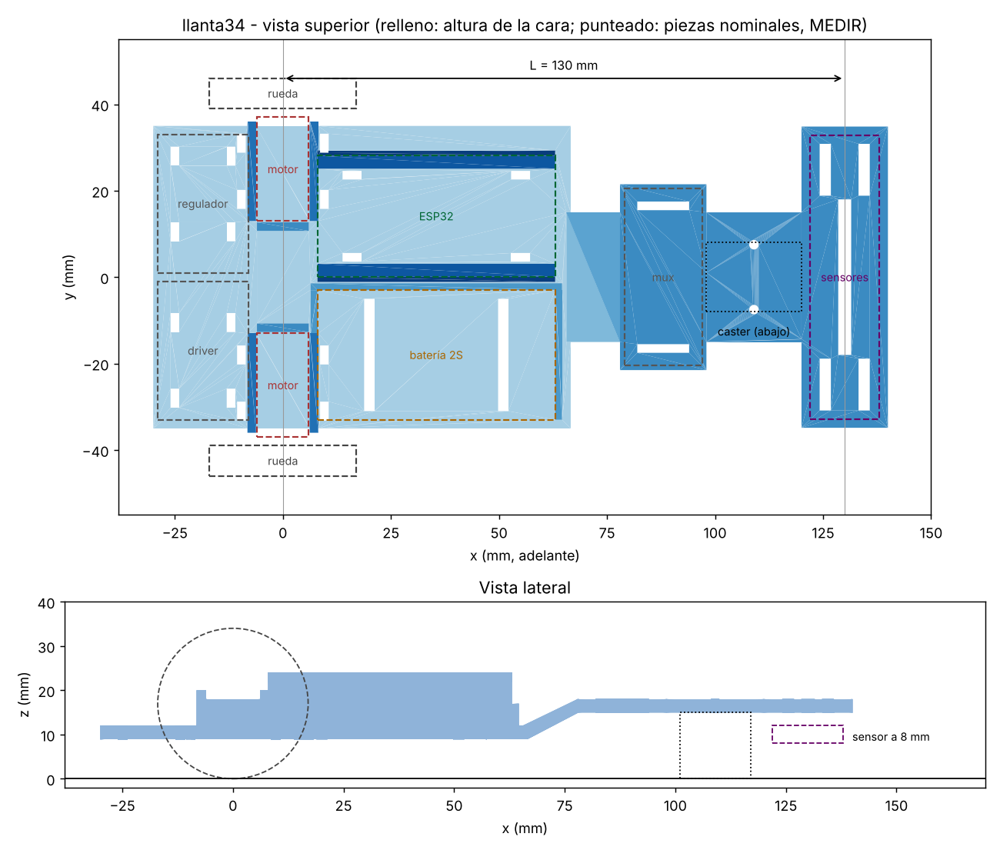

# Speed Follower — Entregable 2: prototipo fabricable (Plan B)

Fecha: 31 oct 2026 · Rama: `engineering/speed-follower` · Base: [ARQUITECTURA_SF.md](ARQUITECTURA_SF.md) (entregable 1).
Etiquetas: `[Probado en software]` `[Verificado documentalmente]` `[Estimado]` `[MEDIR]` `[Pendiente]`.

## 0. Qué contiene y qué no
| Pieza | Archivo | Estado |
|---|---|---|
| Control C2 en C++ puro | `speed-follower/firmware/sf/sf_logica.*` | `[Probado en software]`: igual a Python con diferencia máxima 1.93e-05 en 12 000 pasos |
| Firmware de pruebas ESP32 | `speed-follower/firmware/sf/sf.ino` + `hardware_sf.*` + `pines_sf.h` | Sintaxis OK contra el stub (8 combinaciones). **No compilado con arduino-esp32** (H01 sigue pendiente) |
| Chasis impreso | `speed-follower/cad/chasis_planB_llanta34.stl` (+ `.png`, `.txt`, generador) | Malla cerrada; medidas nominales: **medir piezas antes de imprimir** |
| BOM | `docs/speed-follower/BOM_SF.csv` | 22 renglones; precios verificados el 31 oct donde se indica |
| KiCad (Plan A) | — | **No se generó.** Depende de que el diseñador de PCB confirme tiempos (regla del encargo) |

Supuestos de este entregable: que "continúa" aprueba avanzar con las recomendaciones del entregable 1 (SF-1 reactivo, SF-2 Pololu 12 V 15:1, SF-3 DRV8833, SF-4 L = 130 mm, SF-8 Plan B primero). El firmware y el chasis aceptan las alternativas (TB6612, GA12-N20) cambiando una línea o un parámetro.

## 1. Firmware de pruebas

### 1.1 Estructura
```
speed-follower/firmware/sf/      (abrir sf.ino en Arduino IDE; la carpeta se llama igual que el .ino)
  sf_logica.h/.cpp   control C2 + estimación de línea          C++ puro
  posicion.*, estados.*, parametros.h                           copias del firmware anterior (sin cambios)
  pines_sf.h         pines y selección de driver/motor          ÚNICO archivo a editar al recibir piezas
  hardware_sf.*      ADC, mux, PWM, DRV8833 o TB6612            ESP32
  sf.ino             orquestador: estados, calibración, NVS, consola
```
`firmware/seguidor/` (el robot anterior) no se modificó; su bandera `MOTOR_DESDE_BATERIA` sigue en `false`.

### 1.2 Cómo se verificó
- `speed-follower/pruebas/ejecutar.sh`: Python genera vectores dorados (4 configuraciones: Pololu 15:1, GA12 6 V limitado, inversión permitida, freno activo) y el C++ los reproduce; además 11 propiedades: sin inversión por defecto, |ciclo| ≤ 1, rampa respetada, motor de 6 V limitado a 6 V promedio, frena en curva a la velocidad teórica, signo de la corrección, parada a los 0.3 s sin línea. Compilado con `-Werror`, ASan y UBSan. **11 pruebas, 0 fallos.**
- `speed-follower/pruebas/verificar_sintaxis_sf.sh`: todo el firmware contra el stub de Arduino, 2 drivers × 2 motores × API de PWM 2.x/3.x. **Esto no es compilar para el ESP32.**

### 1.3 Driver DRV8833: cómo se manda el PWM
Ficha TI SLVSAR1E, tabla 2 (consultada el 31 oct): `xIN1 = 1, xIN2 = PWM` es "Forward PWM, slow decay". Como `1/1` frena y `1/0` conduce, el ciclo en IN2 es **1 − d**. En reversa se intercambian los pines. Al despertar `nSLEEP` el firmware espera 1 ms (tWAKE de la ficha). Con el robot detenido se ponen las 4 entradas en 0 (rueda libre) y `nSLEEP` en bajo.

### 1.4 Consola (USB, solo con el robot detenido)
`ayuda`, `get`, `set <clave> <valor>`, `save`, `load`, `defecto`, `sens` (lecturas normalizadas + e en mm), `crudo`, `bat`, `diag` (tiempo de lectura), `tel 1` (telemetría: ciclo máx, e, v_cmd, izq, der, inversión), `m <izq> <der> [ms]` (motores con ruedas en el aire, máximo 5 s).
Claves: `v_max a_lat a_lon k_pp kp kd tau_d tau_k inv e_crit d_inv ff_acel t_perdida`. Se guardan en NVS (espacio `speedf`, versión 1).

### 1.5 Primera puesta en marcha (orden obligatorio)
1. Compilar y subir sin motores conectados. Si no compila, anotar el error en `modificaciones/`.
2. `crudo` sobre blanco y negro → fijar `ALTO_ES_NEGRO`. `sens` moviendo una línea de izquierda a derecha → `e` debe **crecer**; si baja, invertir el orden de canales.
3. `bat` contra multímetro (error < 0.1 V).
4. Ruedas en el aire: `m 0.2 0` debe mover **la izquierda hacia adelante**; si no, `INVERTIR_IZQ`. Igual con la derecha.
5. Calibrar (CAL), arrancar con `set v_max 0.4`, subir de 0.1 en 0.1 m/s. Con `tel 1`, la columna de inversión debe quedar en 0.

## 2. Conexiones (Plan B, módulos)
| Señal | ESP32 | Módulo | Nota |
|---|---|---|---|
| Batería + | — | fusible → interruptor → VM del driver y entrada del MP1584 | 470 µF junto a VM |
| 5 V | VIN | salida del MP1584 | Ajustar a 5.0 V **antes** de conectar el ESP32 |
| 3.3 V | 3V3 | VCC del sensor, VCC del mux | Todo lo que toca un GPIO trabaja a 3.3 V |
| Mux S0-S3 | 25, 26, 27, 33 | 74HC4067 | — |
| Mux SIG | 34 (ADC1) | 74HC4067 SIG | Canales 0-7 = sensores de izquierda a derecha (VERIFICAR) |
| Emisores | 13 | pin IR/LEDON del sensor | Polaridad: `EMISOR_ACTIVO_ALTO` (VERIFICAR) |
| AIN1 / AIN2 | 19 / 21 | DRV8833 motor izquierdo | — |
| BIN1 / BIN2 | 22 / 23 | DRV8833 motor derecho | — |
| nSLEEP | 16 | DRV8833 nSLEEP (EEP en algunos módulos) | Alto = activo |
| START / CAL | 4 / 14 | botones a GND | Pull-up interno |
| Batería (medición) | 36 | divisor 100 kΩ / 33 kΩ | 8.4 V → 2.08 V |
| LED | 2 | LED de la placa | — |
Con TB6612: PWMA 18, AIN1 19, AIN2 21, PWMB 17, BIN1 22, BIN2 23, STBY 16 (`#define DRIVER DRIVER_TB6612`).

## 3. Chasis Plan B
Generador paramétrico: `cd speed-follower/cad && python3 generar_chasis.py` (manifold3d, trimesh, matplotlib).



| Dato | Valor | Origen |
|---|---|---|
| Robot completo | 170 × 92 mm (reglamento 200 × 100) | `[Estimado]` con llanta 34 × 7 y vía de 85 mm |
| Pieza impresa | 170 × 72 × 15 mm, una sola pieza | `[Estimado]` |
| Placa | 3 mm, de z = 9 a 12 mm; el motor se apoya encima con su eje a la altura del de la llanta | `[Estimado]` |
| Cuello y almohadilla de sensores | z = 15 mm (lo fija la altura del apoyo 3Pi, 15 mm) | `[MEDIR]` el apoyo |
| Separadores barra–almohadilla | 3 mm, para que el sensor quede a 8 mm del piso | `[MEDIR]` la altura óptima del sensor real |
| Masa de la pieza (PLA 1.24 g/cm³) | 26.6 / 35.5 / 44.4 g con relleno efectivo 60 / 80 / 100 % | `[Estimado]` |

Sujeción: motores en cunas con 2 cinchos cada uno; batería con velcro; ESP32 sobre rieles de 10 mm (libran los pines) con cinchos; multiplexor de través sobre el cuello; driver y regulador en la zona trasera con cinchos; apoyo con 2 tornillos M2; barra con M3 y separadores.

**Antes de imprimir**, medir y corregir en `generar_chasis.py` (clase `P`): llanta, motor (largo con o sin encoder), batería, módulo del mux, agujeros de la barra y del apoyo, altura óptima del sensor. El script se niega a generar STL si algo choca o rompe el reglamento.

**Llanta de 43 × 19 mm:** con ella el robot mediría 104 mm de ancho con la vía de 85 mm. Con vía de 77 mm cabría (96 mm), pero la placa junto a las llantas se angosta, la batería se va hacia adelante y el multiplexor ya no cabe antes del apoyo. Por eso **no se generó STL** para esa llanta: exigiría rediseñar el acomodo y volver a simular (diámetro y vía distintos).

## 4. Masa del robot `[Estimado]`
| Parte | g | Fuente |
|---|---|---|
| ESP32 | 11 | UNIT |
| Batería 2S 500 mAh | 36 | Turnigy (ARQUITECTURA_SF §8) |
| 2 motores Pololu con encoder | 22 | Core Electronics |
| 2 llantas 34 × 7 | 6.4 | UNIT |
| Apoyo 3Pi | 10 | UNIT |
| Barra de sensores | 5.5 | UNIT |
| Driver, regulador, mux, cables, tornillos | ≈ 20 | Supuesto |
| Chasis impreso | 27-44 | Este generador |
| **Total** | **≈ 138-155 g** | Menor al objetivo de 200 g y muy lejos de 450 g. **Pesar con báscula.** |

## 5. Costo `[Verificado documentalmente]` el 31 oct, sin envío
- Configuración recomendada, partidas con precio: **≈ $343 MXN** (ESP32, sensor, mux, DRV8833, llantas 34 × 7, apoyo, regulador, fusible, interruptor, conector, capacitores, divisor). Más $227 del cargador si no tienen uno.
- **Sin precio:** motores Pololu 12 V 15:1 (no encontrados en México), batería, botones, filamento, sujeción y cable.
- Con los GA12-N20 locales en lugar de Pololu: +$178.
- La llanta 34 × 7 **no tenía existencia** el 31 oct.

## 6. Pendientes que bloquean el entregable 3 (versión competitiva validada)
| # | Pendiente | Quién | Bloquea |
|---|---|---|---|
| 1 | Compilar `sf.ino` con arduino-esp32 3.x | Equipo | Subir el firmware |
| 2 | Decidir SF-1 (¿mapa?) y SF-2 (¿Pololu o GA12?) y cotizar Pololu | Equipo | Compra de motores |
| 3 | Llanta 34 × 7 sin existencia: esperar, buscar 32-34 mm en otra tienda o rediseñar para 43 × 19 | Equipo | Chasis |
| 4 | Encapsulado del DRV8833 de UNIT (PWP o PW) | Al recibirlo | Driver |
| 5 | Medidas reales (sección 3) | Al recibir piezas | Imprimir |
| 6 | Confirmar impresora y tiempos | Equipo | Chasis |
| 7 | PCB (Plan A): tiempos del diseñador | Equipo | KiCad |
| 8 | Ajuste físico de kp, kd, a_lat, a_lon y μ medido | Pruebas | Velocidad final |

## 7. Cómo reproducir
```bash
speed-follower/pruebas/ejecutar.sh               # C++ contra Python + propiedades
speed-follower/pruebas/verificar_sintaxis_sf.sh  # firmware contra el stub
cd speed-follower/cad && python3 generar_chasis.py
```
