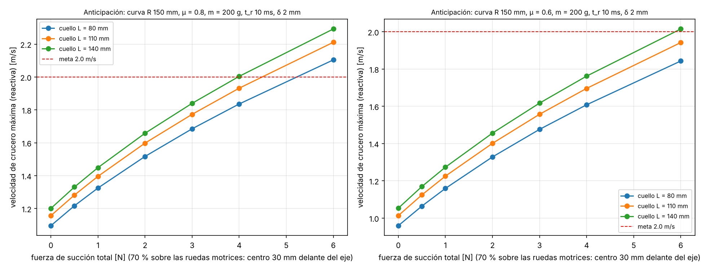
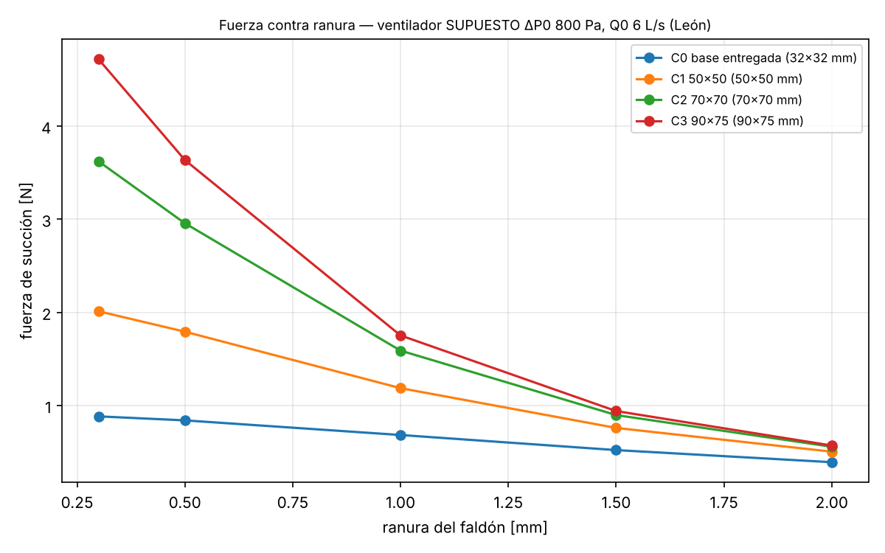

# V2 · Fase 1 — Tracción, anticipación geométrica, succión paramétrica, fallos y energía

Fecha: 3 nov 2026 · Script: `sim/v2/fase1_v2.py` · Parámetros: `config/v2/parametros_fase1.yaml` (cada uno con su tipo y
fuente) · Resultados: `sim/resultados/v2_fase1/` (T1-T9 en CSV, F1-F2 en PNG).

**Todo lo de esta página es CALCULADO con modelos de primer orden sobre escenarios SUPUESTOS.** No es simulación dinámica
(eso es la Fase 4) ni medición. La meta de 2.0 m/s es un **objetivo de diseño**, no una prestación: aquí solo se calcula qué
haría falta para alcanzarla. No tengo la curva del ventilador: donde hace falta, la reemplazan variables explícitas.

## 1. Modelo y geometría de estudio

- **Tracción en 2 ruedas traseras con apoyo delantero** (como V1): el apoyo (bola o patín) no aporta fuerza lateral ni de
  frenado; toda la adherencia sale de las ruedas motrices. Reparto estático: N_motriz = m·g·(b − x_cg)/b + F_s·(b − x_s)/b.
- Transferencia de carga: al frenar, la carga pasa al apoyo, a_fr = μ·N_motriz / [m·(1 + μ·h/b)]; al acelerar, al eje,
  a_ac = μ·N_motriz / [m·(1 − μ·h/b)]; en curva, entre rueda interior y exterior ΔN = m·a_y·h/W. Círculo de fricción con la
  transferencia: m·√(a_x² + a_y²) ≤ μ·(N_motriz − m·a_x·h/b) (resuelto en forma cerrada).
- **Geometría de estudio** (supuesta; la V2 se diseña en la Fase 3): b = 100 mm (eje-apoyo), x_cg = 25 mm, h = 20 mm,
  vía W = 85 mm, centro de la succión x_s = 30 mm delante del eje. Masa de referencia 200 g; μ de referencia 0.8 (sin medir).
- **Anticipación** (§4): la barra, a L delante del eje, sigue la línea; el eje la persigue como un remolque (tractriz), así que
  el robot empieza a girar antes de que el eje llegue a la curva. El robot **no conoce la pista**: detecta la curva cuando la
  línea se separa δ de la prolongación de la recta (s_det = √(2·R·δ) dentro de la curva), reacciona en t_r y frena dentro del
  círculo de fricción. Se busca la mayor velocidad de crucero que nunca excede la adherencia.

## 2. Tracción requerida (T1, calculado) — m = 200 g, μ = 0.8

F_lateral = m·v²/r. Downforce con la fórmula del enunciado (todo el robot adhiere): F ≥ max(0, m·v²/(μ·r) − m·g). Con 2 ruedas
motrices y apoyo sin agarre lateral, solo cuenta la parte de la succión que cae sobre las ruedas, y la exigencia sube:

| Radio | v | F lateral | a lateral | Downforce (fórmula del enunciado) | Downforce (2 ruedas motrices, x_s 30 mm) |
|---|---|---|---|---|---|
| 0.15 m | 1.0 m/s | 1.33 N | 0.68 g | 0 | 0.28 N (28 gf) |
| 0.15 m | 1.5 m/s | 3.00 N | 1.53 g | 1.79 N (182 gf) | 3.26 N (332 gf) |
| 0.15 m | 2.0 m/s | 5.33 N | 2.72 g | 4.71 N (480 gf) | **7.42 N (757 gf)** |
| 0.30 m | 2.0 m/s | 2.67 N | 1.36 g | 1.37 N (140 gf) | 2.66 N (271 gf) |
| 0.50 m | 2.0 m/s | 1.60 N | 0.82 g | 0.04 N | 0.76 N (77 gf) |

Conclusión: **tomar la curva más cerrada del reglamento (R 150 mm) a 2.0 m/s no es realista** (casi 4 veces el peso del
robot en succión). La meta de 2.0 m/s se interpreta, como dice el enunciado, para las rectas; las curvas se toman más lento y la
pregunta clave es si se puede **frenar a tiempo** (§4).

## 3. Distribución de carga por rueda (T2, calculado) — m = 200 g, μ = 0.8, x_s = 30 mm

| Caso | Sin succión: eje / rueda int. / rueda ext. / apoyo (N) | Con 3 N de succión: eje / int. / ext. / apoyo (N) |
|---|---|---|
| Estático | 1.47 / 0.74 / 0.74 / 0.49 | 3.57 / 1.79 / 1.79 / 1.39 |
| Aceleración máxima | 1.75 (a 7.0 m/s²) / 0.88 / 0.88 / 0.21 | 4.25 (a 17.0 m/s²) / 2.13 / 2.13 / 0.71 |
| Frenado máximo | 1.27 (a 5.1 m/s²) / 0.63 / 0.63 / 0.69 | 3.08 (a 12.3 m/s²) / 1.54 / 1.54 / 1.88 |
| Curva al límite | 1.47 (a_y 5.9 m/s²) / **0.46 / 1.01** / 0.49 | 3.57 (a_y 14.3 m/s²) / **1.11 / 2.46** / 1.39 |
| Frenado en curva (a_y al 50 %) | 1.30 (a_x 4.3) / 0.51 / 0.79 / 0.66 | 3.16 (a_x 10.4) / 1.24 / 1.91 / 1.81 |

- El frenado **descarga** las ruedas motrices (la carga se va al apoyo): por eso a_fr < a_ac.
- En curva la rueda interior queda con 30-31 % de la carga del eje; el vuelco lateral empieza en a_y ≈ 15.6 m/s² sin succión
  y ≈ 37.9 m/s² con 3 N (la succión actúa a nivel del piso y no agrega momento de vuelco): **no es un límite** con estas alturas.
- Toda la succión que cae sobre el apoyo se pierde para frenar y doblar: **el centro de la cámara debe estar lo más cerca posible
  del eje motriz** (cuantificado en §4).

## 4. Validación de anticipación geométrica (T3, T3b, F1) — EL resultado crítico

Velocidad de crucero máxima con la que un robot **reactivo** puede encontrarse la curva más cerrada (R 150 mm), detectarla,
reaccionar y frenar sin exceder la adherencia (m 200 g, μ 0.8, t_r 10 ms, δ 2 mm, x_s 30 mm):

| Succión total | Cuello L = 80 mm | L = 110 mm (V1) | L = 140 mm |
|---|---|---|---|
| 0 N | 1.10 m/s | 1.16 m/s | 1.20 m/s |
| 1 N | 1.33 | 1.40 | 1.45 |
| 2 N | 1.52 | 1.60 | 1.66 |
| 3 N | 1.69 | 1.77 | 1.84 |
| 4 N | 1.84 | 1.93 | **2.00** |
| 6 N | 2.10 | 2.21 | 2.29 |

**Respuesta a la validación pedida:**

1. **Sin succión, ningún cuello posible permite 2.0 m/s**: alargar el cuello de 80 a 140 mm solo sube la velocidad de
   1.10 a 1.20 m/s. El cuello tiene dos topes físicos: L < 150 mm (si no, el eje no puede seguir una curva de R 150 mm con la barra
   sobre la línea) y la caja de 200 mm. Un cuello más largo además **baja** la velocidad en la curva (el eje recorta por dentro:
   0.87 → 0.59 m/s del CG con L 80 → 140 mm sin succión). **No hay rediseño del cuello que resuelva el problema por sí solo.**
2. **Con succión sí**: la succión sube a la vez la velocidad de curva y la desaceleración. Fuerza total mínima para que la
   velocidad de crucero reactiva llegue a 2.0 m/s (T3b):

   | Centro de la succión | L 80 mm | L 110 mm | L 140 mm | Peso aparente (200 g + succión), L 110 mm |
   |---|---|---|---|---|
   | Sobre el eje (x_s = 0) | 3.63 N | **3.12 N** | 2.78 N | 518 g |
   | 30 mm delante | 5.19 N | 4.45 N | 3.97 N | 654 g |
   | 60 mm delante | 9.07 N | 7.79 N | 6.95 N | 994 g |

   Con μ = 1.0 baja a 2.25 N (x_s 0, L 110); con μ = 0.6 sube a 4.56 N. Con 150 g, 2.34 N; con 250 g, 3.89 N.
3. **Sensibilidad** (L 110, 4 N): latencia 5 / 10 / 20 ms → 1.98 / 1.93 / 1.85 m/s; umbral de detección 2 / 4 mm → 1.93 / 1.89 m/s.
   La latencia y el umbral importan poco frente a la succión, la masa y μ.
4. **Diseño que sale de aquí** (para las Fases 2-3): cuello de 110-140 mm, cámara de succión **centrada sobre el eje motriz**,
   ≥ 3-4 N de succión real, masa ≤ 200 g. Si la succión no se permite o no se alcanza, la meta realista sin mapa es ≈ 1.2 m/s.
5. **Alternativa sin succión** (depende de la pregunta 3 de la auditoría): con un mapa aprendido, el robot frena antes de cada
   curva; la vuelta cuasiestática baja 20 % sin succión (T8b). Con succión alta, el mapa casi no aporta (−3 % con 4 N).

Comparación con la fórmula simple del enunciado (frenar en línea recta antes de la curva), d = v·t + (v² − v_c²)/(2a): con L 110
mm, 4 N, d_requerida = 95 mm contra ≈ 86 mm disponibles (L − s_det): la fórmula dice "no alcanza" y el modelo cinemático da
1.93 m/s. La diferencia es que el robot ya empieza a girar y a frenar a la vez mientras el eje entra en la curva; la fórmula
simple es la cota conservadora (T4 tiene las distancias de parada completas).

## 5. Frenado (T4, calculado) — d = v·t + v²/(2a)

| v | a = 5 m/s² | 10 m/s² | 15 m/s² | 20 m/s² |
|---|---|---|---|---|
| 2.0 m/s, t = 10 ms (parada total) | 0.42 m | 0.22 m | 0.15 m | 0.12 m |
| 2.0 m/s, t = 10 ms (hasta 1.0 m/s) | 0.32 m | 0.17 m | 0.12 m | 0.10 m |

Sin succión el frenado máximo es ≈ 5 m/s² (§3): perder la línea a 2.0 m/s deja 0.4 m de recorrido.

## 6. Succión paramétrica y punto de funcionamiento real (T5, T6, F2)

No se usan la presión máxima y el caudal máximo a la vez. El punto de funcionamiento es la intersección de:
- **Curva del ventilador** (forma supuesta, a reemplazar por la del fabricante): ΔP_f(Q) = ΔP₀·[1 − (Q/Q₀)²], menos la pérdida
  del conducto de entrada K·½ρ·(Q/A_entrada)² con A_entrada = garganta de Ø18.6 mm de la base entregada.
- **Curva de la cámara**: fuga por la ranura del faldón, Q = C_d·perímetro·ranura·√(2ΔP/ρ) (C_d 0.6 supuesto).
- **Fuerza**: F = ΔP_cámara·A_efectiva, con A_efectiva = área de la cámara + mitad del labio del faldón (2 mm).
- Densidad del aire en León: 1.025 kg/m³ (ISA a 1 815 m).

Fuerza de succión (N) con el ventilador intermedio supuesto (ΔP₀ 800 Pa, Q₀ 6 L/s) y entre paréntesis con 400 / 1 200 Pa:

| Cámara | Ranura 0.3 mm | 0.5 mm | 1.0 mm | 2.0 mm |
|---|---|---|---|---|
| C0: base entregada (31.8 × 31.8 mm) | 0.88 (0.44 / 1.33) | 0.84 | 0.68 | 0.39 |
| C1: 50 × 50 mm | 2.01 (1.00 / 3.04) | 1.79 | 1.19 | 0.51 |
| C2: 70 × 70 mm | 3.62 (1.79 / 5.51) | **2.96** (1.44 / 4.59) | 1.59 | 0.56 |
| C3: 90 × 75 mm | 4.72 (2.32 / 7.22) | 3.64 (1.76 / 5.70) | 1.75 | 0.57 |

- Con ranuras ≤ 0.5 mm el ventilador trabaja cerca de su presión de cierre (64-97 % de ΔP₀): **lo que más importa del
  ventilador es su presión de cierre en León**, no su caudal máximo. El caudal de trabajo es 1-3 L/s.
- **Con la base entregada como única cámara, la succión no llega a 1.4 N** con ningún ventilador del barrido: hace falta una
  cámara con faldón (justifica la modificación permitida: conducto/cámara, no el rotor).
- Para los ≈ 3.1 N de §4 (centro sobre el eje, L 110 mm): cámara de ≈ 70 × 70 mm, ranura ≤ 0.5 mm y ΔP₀ ≥ ≈ 850 Pa **en León**
  (≈ 1 000 Pa en una ficha medida a nivel del mar). Con el rotor entregado eso es ≈ 30 000 RPM o más bajo carga
  (`ANALISIS_VENTILADOR.md` §2): **se confirma o se descarta con la curva real**.
- La potencia del aire en el punto de trabajo es 1-3 W; la potencia eléctrica del ventilador es otro dato pendiente.

## 7. Requisitos que pasan a la Fase 2 (calculados, T9 y anteriores)

| Requisito | Valor | De dónde |
|---|---|---|
| Fuerza de succión real | ≥ 3.1 N con el centro sobre el eje (≥ 4.5 N si queda a 30 mm) | T3b, L 110 mm, 200 g, μ 0.8 |
| Cámara y faldón | ≈ 70 × 70 mm centrada en el eje motriz, ranura ≤ 0.5 mm, sin contacto abrasivo (R11) | T6 |
| Presión de cierre del ventilador | ≥ ≈ 850 Pa en León | T6 |
| Masa total | ≤ 200 g (cada 50 g extra piden ≈ 0.8 N más de succión) | T3b |
| Par por rueda (llanta de 32 mm, 200 g) | 0.16 kg·cm para 10 m/s², 0.33 kg·cm para 20 m/s² | T9 |
| Velocidad de rueda a 2.0 m/s | 1 194 rpm (llanta de 32 mm), 1 364 rpm (28 mm), 955 rpm (40 mm) | T9 |
| Potencia mecánica por motor a 2.0 m/s | 2-4 W (10-20 m/s²) | T9 |

Los motores V1 (≈ 0.10 kg·cm de bloqueo a 7.4 V) no cumplen el par: se reemplazan en la Fase 2.

## 8. Fallos del sistema de succión (T7, T7b, calculado sobre el escenario C2 · 0.5 mm · ΔP₀ 800 Pa)

Velocidad planeada en la curva de R 150 mm: 90 % de la máxima con succión nominal (1.10 m/s, L 110 mm).

| Fallo | Succión que queda | Uso de la adherencia en la curva | Resultado | Cómo se detecta |
|---|---|---|---|---|
| Nominal | 2.96 N (100 %) | 0.81 | — | — |
| **Pérdida total de alimentación** | 0 | **1.95** | **Derrapa** | Corriente ≈ 0; tacómetro sin pulsos |
| RPM al 80 % | 1.89 N (64 %) | 1.03 | Derrapa (justo) | Tacómetro |
| RPM al 60 % | 1.07 N (36 %) | 1.29 | Derrapa | Tacómetro |
| Batería baja sin compensar (7.0 V; ΔP ∝ V²) | 2.05 N (69 %) | 0.99 | En el límite | Medición de la batería |
| Faldón gastado: ranura 0.5 → 1.0 mm | 1.59 N (54 %) | 1.11 | Derrapa | **Solo con sensor de presión** o por deslizamiento |
| Pérdida de depresión: ranura 2.0 mm (escalón, unión del tablero) | 0.56 N (19 %) | 1.54 | Derrapa | Solo con sensor de presión o por deslizamiento |
| Entrada obstruida al 75 % | 1.46 N (49 %) | 1.15 | Derrapa | Corriente del ventilador (cambia con el caudal) |
| Falla del sensor de supervisión | desconocida | — | El firmware no sabe si hay succión | Plausibilidad entre señales |

Tiempo hasta el derrape si el ventilador se apaga en plena curva (la presión cae con constante τ, supuesta; velocidad al 90 %):
τ = 50 / 100 / 200 / 400 ms → **20 / 39 / 79 / 157 ms**. Con 80 % de uso: 48 / 96 / 191 / 383 ms.

**Estrategia segura del firmware (aun sin medir presión directamente):**
1. **Autoprueba antes de START**: arrancar el ventilador, verificar corriente y RPM dentro de su ventana; si falla, correr en
   modo "sin succión" (tablas de velocidad sin crédito de succión). El robot no se mueve durante la prueba (C03).
2. **Crédito de succión limitado**: planear las curvas con una fracción de la succión estimada (por ejemplo 60-70 %), no con
   el 100 %; la tabla muestra que una caída del 20 % de RPM ya hace derrapar si se planea con el total.
3. **Mantener la presión constante**: control de RPM en lazo cerrado o compensación del mando con la tensión medida de la
   batería (elimina el caso "batería baja").
4. **Supervisión continua** (corriente, RPM, tensión): ante una caída, pasar de inmediato al perfil sin succión; en recta,
   frenar; en curva, bajar velocidad con el margen que deja el círculo de fricción.
5. **Pérdidas de depresión** (ranura, obstrucción) que corriente y RPM no ven: detectar el deslizamiento (comparar la guiñada
   de un giroscopio con la que dan los encoders, y la aceleración medida con la ordenada) o agregar un sensor de presión
   diferencial (decisión de la Fase 2).
6. **Sensor de supervisión en falla** (señal ausente o incoherente con las otras): asumir que **no hay succión**.
7. **Arranque del ventilador antes de soltar los motores**: su par de reacción hace girar al robot (§3 de `ANALISIS_VENTILADOR.md`).

## 9. Energía (T8, calculado; vuelta cuasiestática, robot reactivo, 4 pistas sintéticas)

Leyes de semejanza: ΔP ∝ RPM², Q ∝ RPM, P ∝ RPM³. La potencia eléctrica máxima del ventilador es desconocida: se barre 5, 10 y 20 W.

| Escenario | RPM | Succión | Crucero | Vuelta media | Energía del ventilador por vuelta (5 / 10 / 20 W máx.) | Caída de tensión |
|---|---|---|---|---|---|---|
| Sin ventilador | 0 | 0 | 1.16 m/s | 3.63 s | 0 | 0 |
| Reducida | 50 % | 0.74 N | 1.34 m/s | 3.13 s (−14 %) | 2 / 4 / 8 J | ≤ 0.07 V |
| Intermedia | 75 % | 1.66 N | 1.53 m/s | 2.74 s (−24 %) | 6 / 12 / 23 J | ≤ 0.23 V |
| Máxima | 100 % | 2.96 N | 1.77 m/s | 2.40 s (−34 %) | 12 / 24 / 48 J | ≤ 0.54 V |

- **La mejora en curvas compensa con mucho el consumo**: en la vuelta, el ventilador gasta ≤ 1.8 mAh de una batería de 450 mAh.
  La energía **no** es el límite; lo son la masa, la corriente pico (caída de tensión de hasta 0.5 V que también frena a los
  motores) y la legalidad.
- Los tiempos son de un modelo cuasiestático con seguimiento perfecto: solo valen **en relativo**. (Con el mismo tipo de modelo V1 da
  3.63 s, contra 5.81 s de la simulación dinámica de V1.)

## 10. Tabla de escenarios (resumen de la Fase 1)

| Área | Escenario | Resultado | Tipo |
|---|---|---|---|
| Tracción | R 150 mm a 2.0 m/s, 200 g, μ 0.8 | 4.7 N (fórmula del enunciado) / 7.4 N (2 ruedas motrices): no realista | Calculado |
| Tracción | R 300 mm a 2.0 m/s | 1.4 / 2.7 N | Calculado |
| Anticipación | Sin succión, cualquier cuello 80-140 mm | Crucero máx. 1.10-1.20 m/s: **2.0 m/s imposible** | Calculado |
| Anticipación | 4 N, L 140 mm, x_s 30 mm | 2.00 m/s | Calculado |
| Anticipación | Succión sobre el eje, L 110 mm | 2.0 m/s con 3.1 N (peso aparente 518 g) | Calculado |
| Succión | Base entregada como cámara | ≤ 1.3 N en todo el barrido: **insuficiente** | Calculado sobre supuestos |
| Succión | Cámara 70 × 70, ranura 0.5 mm, ΔP₀ 800 Pa | 2.96 N; con 1.0 mm, 1.59 N | Calculado sobre supuestos |
| Fallos | Pérdida total en curva | Derrape en 20-160 ms (τ 50-400 ms) | Calculado sobre supuestos |
| Fallos | RPM −20 % / ranura ×2 | 64 % / 54 % de la succión: derrape si se planea con el 100 % | Calculado sobre supuestos |
| Energía | Máxima contra sin ventilador | −34 % de tiempo por ≤ 48 J por vuelta | Calculado (cuasiestático) |
| Reglamento | Succión permitida, peso aparente, mapa entre intentos, faldón | **Sin respuesta: bloquean** | Verificado documentalmente (pendiente de consulta) |

## 11. Límites de estos modelos

Fricción de Coulomb con μ constante (sin dependencia de la carga ni de la velocidad de deslizamiento); presión uniforme en la
cámara; forma de la curva del ventilador supuesta; ranura constante (sin cabeceo ni irregularidades); seguimiento perfecto de la
línea (la barra siempre sobre ella); apoyo sin fricción lateral; los motores no limitan el frenado (el requisito de par se da
aparte); pistas sintéticas. La Fase 4 lleva todo esto al simulador dinámico con el ventilador real.
