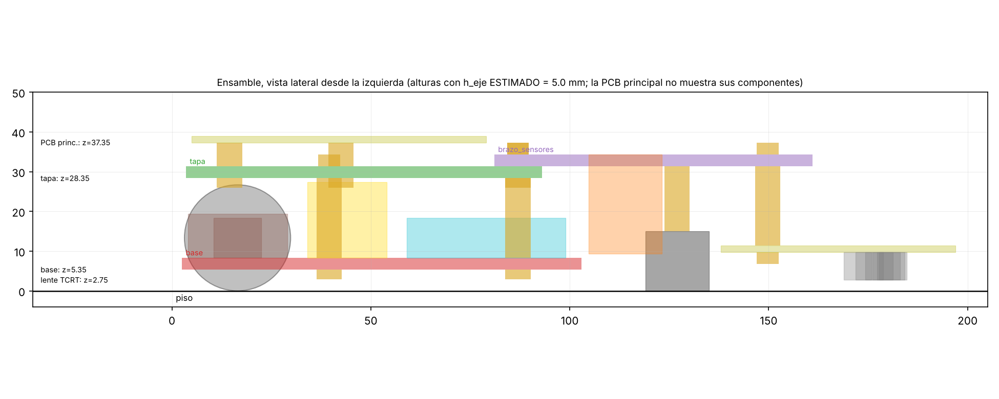

# Chasis final de acrílico 3 mm (corte láser) — rama `seguidor-caseroV2`

> **Estado al 17 nov 2026, 23:40: NINGUNA PIEZA ESTÁ APTA PARA CORTE.** Las tres son **PROVISIONALES**: falta el kerf
> y unas pocas medidas (sección 6). La geometría es nominal y está marcada como "PENDIENTE DE KERF".
> Esta carpeta es nueva y vigente para V2. No se modificó ningún otro archivo del repositorio.

| Dato de trazabilidad | Valor |
|---|---|
| Rama | `seguidor-caseroV2` |
| Commit base usado para generar | `6a83493eb82d1098cb2cdc24ca1f19619928c20d` (16 nov, "V2: patrones de planchado…") |
| PCB principal leída | `v2/electronica/principal/principal.kicad_pcb`, md5 `a9066741539c3da935c77b6cd58d9cb3` (= el del DRC aprobado) |
| PCB de sensores leída | `v2/electronica/sensores/sensores.kicad_pcb`, md5 `fc65e738860c76cf061ef9a5f05144f7` (= el del DRC aprobado) |
| Generador / verificador | `herramientas/generar_chasis.py` / `herramientas/verificar_chasis.py` (los DXF llevan rama, commit y md5 en su cabecera) |

## 1. Archivos

| Archivo | Qué es | Estado |
|---|---|---|
| `base.dxf` | Placa base 100.5 × 96 mm: motores, batería, ventilador | **PROVISIONAL** — pendiente de kerf y de V9 |
| `tapa.dxf` | Placa superior 89.5 × 96 mm: lleva encima la PCB principal | **PROVISIONAL** — pendiente de kerf |
| `brazo_sensores.dxf` | Brazo frontal 80 × 98 mm: placa de sensores, rueda loca e interruptor | **PROVISIONAL** — pendiente de kerf, V3 y V4 |
| `prueba_kerf.dxf` | Pieza de prueba 60 × 30 mm para medir el kerf y probar ajustes | Cortar **primero** |
| `plantillas/plantilla_taladro_pcb_1a1.pdf` | Plantilla A4 1:1 para taladrar los 5 agujeros M3 en las PCB | Lista; imprimir al 100 % |
| `vistas/*.png` | Vista de cada pieza, ensamble superior y lateral, anidado leído de los DXF | — |
| `medidas.md` | Todas las medidas con su clase y fuente (generado) | — |
| `verificacion.md` / `.json` | Resultado del verificador (generado): 0 errores, 7 avisos, 71 comprobaciones | — |

DXF: R2010, milímetros (`$INSUNITS = 4`), escala 1:1, en coordenadas del robot (X al frente, Y a la izquierda; el origen es la
esquina trasera de la caja de 200 × 100, por eso las piezas no empiezan en 0,0). Capas: **CORTE** (rojo, contornos cerrados) y
**GRABADO** (azul: nombre de la pieza, flecha "FRENTE" y líneas guía). Si el texto sale **en espejo**, la placa está volteada.

## 2. Reglamento verificado en el repositorio
Fuente: `docs/requisitos.md`. Caja de **200 mm de largo × 100 mm de ancho**, **sin límite de altura**, **500 g máximo en todo momento**,
sin extensiones desplegables. Las reglas pueden cambiar hasta el **18 nov**: revisar el correo antes de cortar.

| Comprobación | Resultado |
|---|---|
| Largo total (rueda, placas, tornillos y placa de sensores) | **194.5 mm** (x de 2.5 a 197.0) — cumple con 2.5 / 3.0 mm de margen |
| Ancho de las placas de acrílico | 96 mm (base y tapa), 98 mm (brazo) — cumple |
| **Ancho con ruedas** | **SIN VERIFICAR.** Depende de los motores con terminales y del rin (P-V2-34). Cumple solo si **G + 2·hueco ≤ 6.8 mm** (ver V2). Con valores ESTIMADOS da 98.2 mm |
| Altura | Sin límite |
| Peso | **≈ 303 g ESTIMADO** (acrílico calculado ≈ 81 g; lo demás estimado o de ficha). Confirmar con báscula |

## 3. Arquitectura elegida (recomendada; el equipo respondió "sin preferencia")

- **Base** (abajo): motores N20 atrás, espalda con espalda, sujetos con sus soportes en **ranuras M2** (absorben la posición, que no está
  medida); batería LiPo delante de los motores (cinchos por 4 ranuras); ventilador 4010 atornillado con su toma de Ø34 (D-V2-26).
- **Tapa** (en medio): sobre 4 separadores de 20 mm, pasa **por encima de las ruedas** y lleva **encima la PCB principal** con 3 separadores
  de 6 mm. Nada queda sobre la PCB: START, CAL, RESET y el USB-C quedan libres, y el diseño **no depende de la altura** de los componentes
  de la PCB principal (no está medida).
- **Brazo** (adelante): se atornilla sobre el frente de la tapa con 3 tornillos (dos comparten el separador de la base). La placa de
  sensores **cuelga debajo** con 2 separadores de 20 mm; la rueda loca cuelga detrás de la placa de sensores; el interruptor KCD1 va en
  el brazo, donde no hay base debajo.

**Diferencia con D-V2-27** (orden propuesto por Alan, "por validar"): el ventilador no puede ir *entre* la PCB principal y los sensores en un
solo nivel, porque el largo daría ≈ 207 mm. Aquí la PCB principal sube a la tapa sobre las ruedas y el ventilador queda debajo de la tapa,
cerca del eje. El orden de atrás hacia adelante (ruedas, PCB, ventilador, sensores) se conserva en planta. **Es una propuesta: no se
registró como decisión.**

## 4. Separación entre placas (todas las alturas desde el piso, z = 0; sin sumar dimensiones repetidas)

| Nivel | z (mm) | Justificación |
|---|---|---|
| Eje de las ruedas | 13.35 | Llanta Ø26.7 (REAL MEDIDO, M08) / 2 |
| Cara de arriba de la base | **8.35** | 13.35 − h_eje; h_eje = 5.0 = mitad del alto del motor (10 mm) con el motor apoyado en la base. **ESTIMADO → medir V1** |
| Cara de abajo de la base | 5.35 | 8.35 − 3.0 (acrílico) |
| Lo más bajo del robot (sin ruedas ni rueda loca) | 2.95 | tuerca M3 (2.4, ESTIMADO) bajo la base. **Solo ruedas y rueda loca tocan el piso** |
| Tope de soporte+motor | 19.35 | 8.35 + 11 (alto del soporte, ficha UNIT) |
| Tope del ventilador | 18.35 | 8.35 + 10 (ficha UNIT); quedan 10 mm de salida de aire bajo la tapa |
| Tope de la llanta | 26.70 | 2 × 13.35 — **es la cota que manda** |
| Cara de abajo de la tapa | **28.35** | 8.35 + separador de **20 mm** → **1.65 mm** sobre la llanta (mínimo pedido 1.5) |
| Tuercas bajo la tapa (H1–H3, J0) | 25.95–28.35 | Ninguna queda sobre una rueda (por eso H2 se movió al centro trasero); sobre la batería solo si esta pasa de ±32 mm |
| Batería (envolvente máxima) | 8.35–27.35 | 19 mm de alto como máximo, 64 × 20 mm en planta (la LiPo no está comprada) |
| Cara de arriba de la tapa = cara de abajo del brazo | 31.35 | 28.35 + 3.0 |
| Cara de abajo de la PCB principal | **37.35** | 31.35 + separador de **6 mm**: deja 3 mm entre las cabezas de B1/B2 y la PCB; las cabezas no quedan bajo ningún pad (≥ 3.2 mm en planta) |
| Cara de arriba de la placa de sensores | 11.35 | 31.35 − separador de **20 mm**; deja 20 mm libres para el mux y J1 (medir V6, < 18) |
| Cara de abajo de la placa de sensores | 9.75 | 11.35 − 1.6 (espesor del CAD; medir V10) |
| **Lente de los TCRT5000** | **2.75** | 9.75 − 7.0 (alto del TCRT, datasheet) − 0 (cuerpo pegado a la PCB, ESTIMADO, V5). Objetivo documentado: 2.5 |
| Espaciador de la rueda loca | 16.35 | 31.35 − 15 (alto de ficha usado como cara de montaje → fondo de esfera, ESTIMADO, V3) |

Si V1 da otra altura de eje, la cara de abajo de la tapa debe seguir ≥ 28.2 mm y el lente cerca de 2.5 mm: se cambian solo los
separadores (combinaciones del kit 6/10/15/20 y tuercas M3 como suplemento). **Los DXF no cambian.** Ejemplo con h_eje = 6.5:
base a 6.85, separador base-tapa 10 + 15 = 25 (tapa a 31.85), brazo-sensores 6 + 15 = 21 + una tuerca de 2.4 → lente ≈ 2.85 mm.

## 5. Agujeros que hay que taladrar en las PCB (autorizado por el equipo el 17 nov)
Las PCB V2 aprobadas **no tienen agujeros de montaje** (la de sensores solo trae los del multiplexor, con cobre a 2.4 mm: un separador
de latón haría corto). Se eligieron puntos con **≥ 3.7 mm sin cobre en las dos caras** (esquina del hexágono 3.18 + 0.5). Los archivos de
KiCad **no se tocaron**; se taladra a mano con `plantillas/plantilla_taladro_pcb_1a1.pdf` (broca piloto 1.5 → 3.2 mm).

| Agujero | KiCad (x, y) | Cobre libre | Notas |
|---|---|---|---|
| H1 PCB principal | (191.0, 74.0) | 10.8 mm | Esquina delantera derecha |
| H2 PCB principal | (148.0, 132.5) | 5.8 mm | Centro trasero, **bajo el ESP32**: atornillar antes de enchufar el ESP32 (V7) |
| H3 PCB principal | (112.0, 104.5) | 6.9 mm | **Bajo el MP1584 U2**: atornillar antes de enchufar U2 (V7) |
| S1 PCB sensores | (104.75, 122.75) | 4.2 mm | Solo **2.65 mm** de material al borde: taladrar despacio. Girar el hexágono con una cara plana hacia Q1 |
| S2 PCB sensores | (187.5, 120.0) | 4.9 mm | — |

## 6. Medidas que necesito con vernier (en orden de prioridad)

**Antes de cortar el brazo y la base:**
- **K — Kerf.** Cortar `prueba_kerf.dxf` y medir: (a) el largo exterior de 60.00 y el ancho de 30.00; (b) el cuadro interior de 10.00.
  Kerf = 60.00 − largo medido ≈ hueco medido − 10.00. Decir también si el software del láser compensa. Probar en la misma pieza:
  M3 en Ø3.2, M2 en Ø2.4, el cincho o velcro en la ranura de 3 × 12 y **el interruptor KCD1 en su recorte**.
- **V4 — KCD1.** ¿18.8 × 6.7 mm es el bisel o el cuerpo? Medir el **cuerpo justo debajo del bisel** (largo × ancho) y el bisel. El recorte
  del brazo debe ser el cuerpo. Ver si los clips sujetan en 3 mm (si no, pegamento).
- **V3 — Rueda loca (R03).** (a) Distancia de la cara donde apoyan las orejas de los tornillos a la parte más baja de la esfera;
  (b) diámetro de los 2 agujeros; (c) distancia entre centros (la ficha dice "~15"); (d) si los agujeros van a lo largo del lado de 22 mm.
  El brazo trae ranuras de 3.2 mm que aceptan entre 12 y 18 mm de separación.
- **V9 — Soporte N20.** Con el motor en su soporte: distancia de los agujeros del soporte a la **cara trasera del motor** (la de los
  terminales). Las ranuras de la base cubren de 4 a 20.5 mm desde el centro del robot.

**Antes de armar (no cambian los DXF):**
- **V2 — Ancho con ruedas (P-V2-34, decide si el robot es legal).** Con los cables ya soldados, los dos motores espalda con espalda
  y las ruedas puestas: ancho total de llanta exterior a llanta exterior. Debe ser **≤ 98 mm** (2 mm de margen). Anotar también G
  (separación entre las colas) y el hueco entre el reductor y el rin.
- **V1 — Altura del eje.** Motor en su soporte apoyado en la mesa: altura de la mesa a la parte de arriba del eje − 1.15 (radio del eje de 2.3 mm).
- **V5 — TCRT5000.** Si ya están soldados: distancia de la cara de abajo de la PCB a la cara del lente.
- **V6 — Placa de sensores.** Altura de la pieza más alta de la cara de arriba (mux sobre tira hembra, J1 con su conector). Debe ser < 18 mm.
- **V7 — Tira hembra.** Altura libre entre la PCB y el ESP32 y entre la PCB y el MP1584 U2 (debe caber la cabeza de un M3).
- **V8 — Tornillería del kit.** Largos de tornillo disponibles, alto de la tuerca, medida entre caras del separador y largo de su rosca macho.
- **V10 — Espesores.** Acrílico real (3.0 nominal) y fenólica de las PCB (1.6 del CAD).

## 7. Tornillería

| Uso | Cantidad | Pieza | Cómo va | De dónde |
|---|---|---|---|---|
| Base ↔ tapa (B1–B4) | 4 | Separador M-H **20 mm** | Macho hacia abajo, atraviesa la base, tuerca M3 debajo | Kit |
| Tapa (B1, B2) | 2 | Tornillo M3 × 6–8 | Desde arriba de la tapa al separador | Kit (confirmar largo, V8) |
| Tapa + brazo (B3, B4) | 2 | Tornillo M3 × **10** | Atraviesa brazo y tapa (6 mm) y entra al separador de 20 | Comprar si el kit no trae |
| Tapa + brazo (J0, centro) | 1 + 1 | Tornillo M3 × 10 + tuerca | Atraviesa brazo y tapa | Comprar si el kit no trae |
| Tapa ↔ PCB principal (H1–H3) | 3 | Separador M-H **6 mm** | Macho hacia abajo, tuerca bajo la tapa | Kit |
| PCB principal | 3 | Tornillo M3 × 6 | Desde arriba de la PCB (H2 y H3 antes de enchufar ESP32 y U2) | Kit |
| Brazo ↔ placa de sensores (S1, S2) | 2 | Separador M-H **20 mm** | Macho hacia arriba, tuerca sobre el brazo | Kit |
| Placa de sensores | 2 | Tornillo M3 × 6 | Desde abajo de la placa | Kit |
| Rueda loca | 2 juegos | Espaciador de ≈ **16.35 mm** (6 + 10 apilados + suplemento) | **Depende de V3** (si los agujeros son para M2 hay que comprar tornillería M2 de ~22 mm) | Por definir |
| Soportes de motor | 4 + 4 | Tornillo M2 × 7 + tuerca M2 | Incluidos con los soportes (1.5 + 3 + 1.6 = 6.1 mm, cabe en 7) | Incluido |
| Ventilador | 4 + 4 | Tornillo M3 × **16** + tuerca | 10 mm del marco + 3 de base + 2.4 de tuerca | Comprar si el kit no trae |
| Tuercas M3 en total | 15 | B1–B4, J0, H1–H3, S1–S2, ventilador ×4, + 1 de repuesto | | Kit |
| Batería | 2 | Cincho o velcro ≤ 12 mm de ancho | Por las 4 ranuras de 3 × 12 de la base | Comprar |

Separadores: 6 de 20 mm, 3 de 6 mm y los de la rueda loca. Peso de separadores: ~1 g c/u (P-V2-26).

## 8. Resumen de validación por pieza (detalle en `verificacion.md`)

| Comprobación | base | tapa | brazo |
|---|---|---|---|
| Abre con ezdxf, auditoría sin errores, mm, 1:1 | ✓ | ✓ | ✓ |
| Solo capas CORTE / GRABADO; cortes cerrados; sin duplicados ni superposiciones | ✓ | ✓ | ✓ |
| Medidas exteriores = diseño | 100.5 × 96 | 89.5 × 96 | 80 × 98 |
| Material mínimo al borde / entre cortes (mín. 2 mm) | 2.9 / 2.55 | 2.9 / 4.42 | 3.65 / 4.88 |
| Agujeros que deben coincidir con otra pieza | B1–B4 = tapa ✓ | B1–B4, J0 ✓ | B3, B4, J0 ✓ |
| Agujeros de las PCB recalculados desde KiCad por separado | — | H1–H3 ✓ | S1–S2 ✓ |
| Patrón del ventilador 32 × 32 (dibujo UNIT) / ranuras de motor a 19.5 | ✓ / ✓ | — | — |
| Grabados dentro de la pieza y a ≥ 0.5 mm de los cortes | ✓ | ✓ | ✓ |
| Kerf | **pendiente** | **pendiente** | **pendiente** |
| Medidas físicas que faltan | V9 | — | V3, V4 |
| **Estado** | **PROVISIONAL** | **PROVISIONAL** | **PROVISIONAL** |

Ensamble (sólidos simplificados): sin choques; solo ruedas y rueda loca tocan el piso; START, CAL, RESET, USB-C y KCD1 libres por
encima; centro de masa ESTIMADO en x = 69.4 mm, entre el eje (16.5) y la rueda loca (127): ≈ 52 % del peso en las ruedas.
Anidado leído de los DXF: las 4 piezas caben en **200 × 196 mm** (dos filas) o 325 × 108 mm (una fila), con 5 mm entre piezas.
Caben en una lámina de 30 × 30 cm. **El tamaño real de la lámina no está confirmado.**

**No está validado (no se afirma):** que las piezas cortadas midan lo nominal, la resistencia o rigidez del acrílico, el ajuste real de
tornillos, KCD1 y rueda loca, ni el comportamiento en la pista. Todo eso requiere la pieza de prueba y el armado.

## 9. Cómo regenerar después de medir
1. Editar los valores y la clase en `herramientas/parametros.py` (por ejemplo `h_eje`, `loca_h_montaje`, `kcd1`).
2. `python3 mecanica/chasis_final/herramientas/generar_chasis.py --kerf 0.15` (con el kerf medido; **sin** `--kerf` si el láser compensa).
3. `python3 mecanica/chasis_final/herramientas/verificar_chasis.py` debe terminar con 0 errores.
Requiere `pip install ezdxf matplotlib shapely`.

## 10. Hallazgos y contradicciones (no se cambió ningún archivo existente)
- **Las PCB aprobadas no tienen agujeros de montaje.** Resuelto con los 5 agujeros de la sección 5 (autorizado). Falta registrarlo como decisión (propuesta: D-V2-40).
- `v2/docs/ESTADO-DOCUMENTOS.md` marca toda la carpeta `mecanica/` como **HISTÓRICO**; esta subcarpeta es vigente. Falta añadir la excepción.
- `docs/pendientes-por-confirmar.md`: P-V2-29 (posición del chasis), P-V2-34 (ancho, ahora V2) y R03 (rueda loca, ahora V3) siguen abiertos; esta carpeta los avanza pero no los cierra.
- El `README.md` de la raíz sigue diciendo "componentes sin comprar".
- Los tres puntos anteriores no se tocaron porque la instrucción fue conservar los archivos originales; requieren tu autorización.
